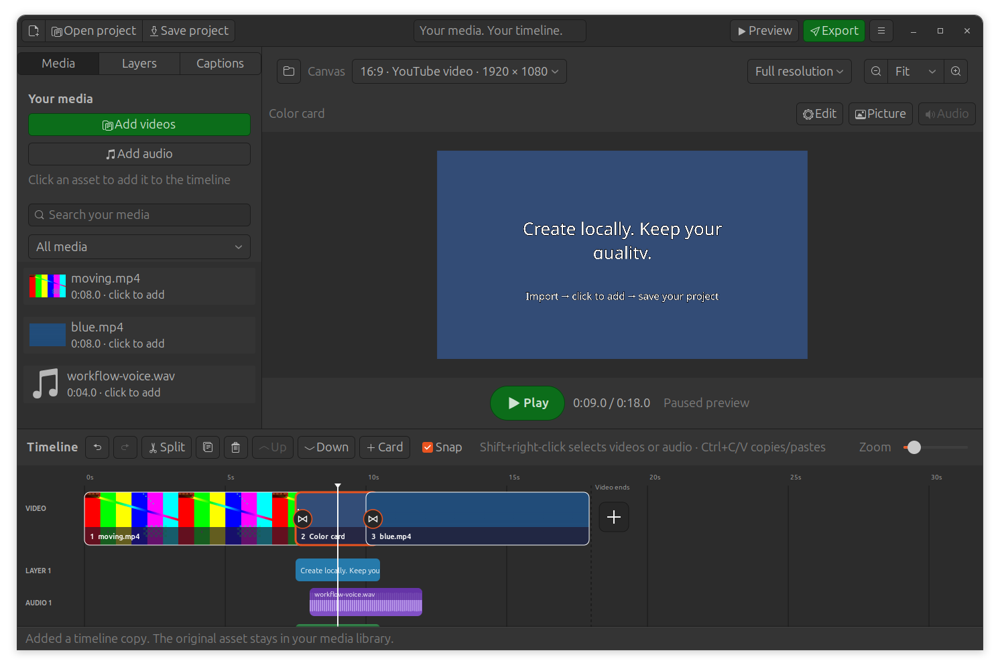

# ClipCanvas 0.10.0

ClipCanvas is a small native Ubuntu app for making social videos from clips and
soundtracks already on your computer. Choose a canvas, arrange clips, add
transitions, layer audio, and export. Your media stays on your computer; there is
no account, upload, subscription, or watermark.

**Project status:** Ubuntu prototype, version 0.10.0. Windows is an intended
platform; a Windows app and installer have not been implemented yet.

- [Canva video feature inventory and implementation status](docs/CANVA-FEATURES.md)
- [Canva UI study and native editor design](docs/UI-STUDY.md)
- [Overhaul and platform development plan](docs/DEVELOPMENT-PLAN.md)
- [Contributing and build instructions](CONTRIBUTING.md)
- [Media library, shortcuts, settings and project workflow](docs/EDITOR-WORKFLOW.md)
- [Shared audio lanes, placement and validation](docs/AUDIO-LANES.md)
- [Export memory use and validation](docs/EXPORT-MEMORY.md)
- [Preview quality, lossless masters and color cards](docs/QUALITY-CARDS.md)
- [Live preview, automatic FPS and validation](docs/LIVE-PREVIEW.md)
- [Dragging/seeking improvements and measured limits](docs/SEEK-PERFORMANCE.md)
- [Transitions, layer animation and attached sound effects](docs/EFFECTS.md)
- [Voice effects and validation](docs/VOICE-EFFECTS.md)
- [Changelog](CHANGELOG.md)

The full feature inventory is in scope for staged development. C44–C49 and
AI/API/MCP connections are deferred. Version 0.7.0 adds live composition playback and automatic source frame rates.
Version 0.7.1 adds continuous playhead scrubbing and preview zoom/pan.
Version 0.8.0 adds full-resolution previews by default, a quality selector,
lossless masters, color cards and visible clip dragging/drop gaps.
Version 0.9.0 adds a saved media library (click assets to place timeline copies),
group selection/copy/paste/Delete, Ctrl+wheel timeline zoom, remembered folders
and audio settings, labelled Save/Open controls and a larger Play button.
Version 0.9.1 adds group volume and a Mute selected videos/audio command.
Shift+right-click a video, then Mute selected videos, or open group Volume,
set 0% and Apply volume to all selected items.
Version 0.9.2 adds multiple audio clips per lane, vertical dragging, drop previews
and a Move to audio lane menu. Audio splits stay in the original lane.
Version 0.9.3 releases paused preview decoders and pending scrub work before
export, reducing simultaneous memory use without changing export quality.
Version 0.9.4 updates the preview and white playhead in the same GTK display
cycle and redraws only their changed timeline areas during playback.
Version 0.10.0 adds the nine illustrated transitions, six entry/exit animations,
Reveal/Highlight/Snake text animations, attached original sound cues and own WAV/MP3
effects. Repeated dragging/seeking reuses a native decoder at the chosen resolution.
Playback time follows each displayed frame; silent scrub frames seek into the active source.
Voice effects include echo, gain, tone filters and a compressor, with isolated A/B listening.
Four editable text/caption styles, logo opacity, Up/Down timeline rows,
positioned overlays and local speech captions are included. The inventory records what is still pending.

This version focuses on local assembly and mixing. It does not include Canva's stock
library, design templates, collaboration, or publishing services.



## Install and open

Built for Ubuntu 24.04 and compatible Ubuntu systems with GTK 3 and FFmpeg.

[Download the current Ubuntu installer](installers/ubuntu/clipcanvas_0.10.0_all.deb)
and its [SHA-256 checksum](installers/ubuntu/SHA256SUMS.txt). On GitHub, use the
file's **Download raw file** button. Future Ubuntu builds are also available in
the [Actions artifacts](https://github.com/lixonic/clipcanvas/actions) after a
successful workflow run. Those artifacts expire after 14 days.

1. Open the supplied `clipcanvas_0.10.0_all.deb` using your software installer, if
   it supports local Debian packages.
2. Alternatively, open a terminal in the folder containing the installer and run:

   ```sh
   sudo apt install ./clipcanvas_0.10.0_all.deb
   ```

3. Open **ClipCanvas** from the applications menu.

The first installation may need an internet connection to fetch Ubuntu's
supporting packages. Video creation works offline. Automatic captions require a one-time model and
library download; recognition then runs offline on your computer. The installer adds a
separate application and does not change VLC.

## Make your first video

1. **Choose a canvas.** Landscape is 16:9 for YouTube, portrait is 9:16 for Reels
   and Shorts, and square is 1:1. The **Canvas** menu remains above
   the preview. Frame rate follows the first source video automatically.
2. **Import local videos.** Use **Add videos** in the media sidebar or the plus
   action after the final timeline clip. Import adds to the saved media library;
   **click an asset** to append an independent timeline copy. Audio copies start
   at the playhead. Importing does not start a timeline or replace your preview.
   File pickers remember accepted folders across launches. Drag clips to reorder them: a lifted
   thumbnail follows your pointer, neighboring clips make room, and **Drop here**
   marks the destination. Hold near the viewport edge to scroll the timeline.
   Release commits one undoable move. Search the
   library by filename or filter it to videos/audio. Collapse the sidebar for
   more canvas space; drag the divider above the timeline to adjust its height.
3. **Edit a selected clip.** Click **Edit** for source trim and playback speed,
   or **Picture** for fit/fill, crop position, rotation, flips, and picture fades.
   These controls open in a compact popover, leaving the canvas clear when
   closed. Click **Apply changes** to keep the entered settings. Video and audio
   speed ranges from 0.25× to 4× and preserves audio pitch.
4. **Choose a transition at the join.** Click the round join button between two
   clips, choose an illustrated effect and duration, then **Apply changes**.
   Direction and colour controls appear for effects that use them. A cut also has a
   join button. Transitions overlap the neighboring clips and shorten the total
   running time. The popover displays the actual overlap, limited to half of
   either adjacent clip. The final clip's plus button adds videos; it is not an
   outgoing transition.
5. **Add soundtracks.** Use **Add audio** or drag local audio files into the app.
   WAV is supported, including 16-bit PCM, 24-bit PCM, and 32-bit floating-point
   audio. Add separate layers for music, voice-over, and effects. Select a layer
   and open **Edit** for its start time, source trim, and speed. Drag its body to
   change when it starts. Drag vertically into another Audio lane to place
   multiple clips beside one another. Snap aligns a clip to another clip's end.
   A lifted waveform and Drop here marker show the destination; an overlap is
   rejected without changing your edit. Right-click → **Move to audio lane**
   can keep the current time or append after that lane's last clip. The menu
   labels the resulting time. Drag into **new lane** for simultaneous music or
   voices. Soundtracks stop at the video end and do not extend
   the composition.
6. **Mix and fade sound.** Right-click a clip or soundtrack and choose **Volume
   and fades…**, or use the selected item's **Audio** button. Enter volume and
   audio fade durations, then **Apply changes**. Selected soundtrack fade
   handles can also be dragged on the waveform; the taper shows the fade. Fade
   out ends at the audible video boundary when a soundtrack extends beyond it.
   Right-click a video for **Mute / Unmute**. **Picture** fades are separate:
   they fade the image from/to black; audio fades change sound level.
7. **Extract a clip's audio.** Right-click the video and choose **Extract audio**.
   The new track starts at the clip's timeline position and retains source trim,
   speed, volume, audio fades, and existing transition audio envelopes. The
   original clip is muted to avoid doubled sound. The track then edits and moves
   independently; subsequent video edits do not move or retime it. Extraction
   is disabled for clips without an audio stream and while an extracted track for that clip
   remains. Undo restores the original sound and removes the new track.
8. **Trim and split.** Drag either selected item's edge to trim; zoom in for
   short clips. **Snap** aligns edits with clip/audio edges and the playhead.
   Drag the ruler to choose a time, then **Split** (or press **S**) to cut the
   selected video or audio item. Video trims close gaps. Audio beyond the video
   end appears faded and is excluded from export. Splits within audio fades or
   too near transitions require shortening that effect first. Right-click also
   exposes split, duplicate, delete, and clip move actions.
9. **Press Play or Preview.** The composition streams directly into the native
   player, with transitions, fades, overlays, captions and mixed sound. No
   preview MP4 is prepared. Press Space to pause/resume; drag the ruler or white
   playhead line to seek. Frames update while you hold and move the line,
   including transitions, captions and overlays. Dragging pauses sound; playback
   resumes on release if it was playing before. Paused scrubbing reuses a native decoder for ordinary scenes and draws
   timed text/images directly, without waiting for the audio mix. Transitions
   and overlay videos use the composed frame renderer.
   Above the preview, use **− / Fit / +** for 25–400% magnification relative to
   Fit. **Ctrl+wheel** zooms; **Shift+drag** or middle-button drag pans when
   enlarged. Choose **Fit** to center the complete canvas again. These controls
   only change your view; they do not crop or resize the export.
   The first main clip supplies the frame rate automatically, including 29.97
   and 59.94. Mixed-rate projects follow that first clip; reordering updates it.
   The selector above the preview defaults to **Full resolution**, matching the
   project canvas. **HD preview** caps the longest edge at 1280 pixels and
   **Fast preview** at 640. Playback, scrubbing and prepared previews follow
   that choice; export always uses original media at the project canvas size.
   Heavy projects or seeks deep into long clips can take time or stutter. Use
   **Project → Render smooth preview…** when you need a prepared playback file.
10. **Export.** **Maximum quality · MP4** is selected by default for social
    videos. Choose **Lossless master · MKV** to preserve the composed frames and
    audio without lossy encoding; these files are very large. Choose the save
    location with the native file chooser and keep the app open until finished.

## Insert a color card between videos

Select the preceding clip and press **+ Card** above the timeline. Choose a
color with Ubuntu's native chooser, enter its duration, then **Insert card**.
Alternatively, right-click a clip and choose **Insert color card before…** or
**after…**. With no selection, the toolbar action inserts at the next clip
boundary at/after the playhead (or at the end).

Select a card and choose **Edit** to change its color and duration. Cards support
reordering, edge trims, split, duplicate, delete, undo/redo and transitions at
both joins. Cards have no source file or sound; soundtracks continue across them.
You can create an entire video from cards with text/logos in **Layers**. Layer,
caption and soundtrack times remain absolute when a card is inserted or resized;
check their timing after changing the story. The card is saved in the project
and included in recovery/portable collection without generating a media file.

## Add echo and adjust a voice track

Right-click a WAV, MP3 or other soundtrack in the timeline and choose
**Voice effects…**. The same editor is available through the **Audio** controls,
including attached video sound. Pick a starting preset (**Neutral**, **Narration**,
**Telephone**, **Echo**) or adjust the tabs:

- **Amplify:** gain from −24 to +24 dB, separate from the track volume.
- **Tone:** bass/treble and optional high-pass/low-pass cutoffs; 0 turns a filter off.
- **Echo:** enable echo, then set delay, first echo level, decay and repeat count.
- **Compressor:** threshold, ratio, attack/release and make-up gain for voice levels.

Use **Listen with effects** and **Without effects** to compare the first 12
seconds of that edited track, then **Apply effects**. **Enable voice effects**
provides bypass; the Neutral preset resets them. Cancel keeps the prior settings.
Applied effects support undo/redo and save/reopen; the timeline shows **FX**.

Press the main **Preview** to hear the complete mix. Preview/export share the
same effect chain. Source waveforms remain a view of the original recording.
No original file is rewritten. Echo stops at the trimmed track/video boundary;
leave silence inside the track if the final words need room to echo. Splitting
starts an independent effect chain in each part. These are track-wide effects,
not selection-based waveform processing, plugin hosting or automatic noise removal.

## Add titles, logos, and visual layers

Open **Layers** in the sidebar and choose **Add text**, **Image / logo**, or
**Overlay video**. Images can also be dropped into the window. Adding/selecting
text opens its editable words and shared style controls. Choose **Clean**,
**Outline**, **Shadow**, or **Highlight**, then **Apply changes**. Presets keep
your words, font family/size, timing, position and overall opacity. You can still
edit fonts, bold/italic, alignment, colors and outline thickness; expand
**Background and shadow adjustments** for line-following backgrounds, padding,
roundness, shadow offsets and softness. Unicode and installed fonts are supported.

For a logo, choose **Image / logo**, select the imported image, and use the
sidebar's **Selected overlay opacity** slider. Transparent PNGs retain their
existing alpha; the slider adjusts overall opacity. **Full video** sets its
visibility from the beginning through the current video end. **Size / position**
opens its geometry controls. Drag the logo on the canvas to place it.

Drag the selected layer on the canvas to position it. Use **Picture** for width,
height, rotation, opacity, fit/fill, and **Bring forward / Send backward**.
Layer sizes and positions follow the canvas when switching aspect ratio.

Select any timeline video, audio, overlay or caption, then use **Up / Down**
above the timeline to arrange its row. All base clips share the Video row and
all caption cues share the Captions row. Multiple sequential audio clips can
share a lane; each visual overlay has its own row. Up/Down moves a whole lane.
Row order is saved with the project and supports undo/redo. It changes display
order only: playback timing, clip sequence and visual stacking stay unchanged.
Use **Bring forward / Send backward** separately to change visual stacking.

Each visual layer has its own timeline row. Drag its body to move it in time,
or its edges to trim its visibility. **Edit → Timing** also accepts exact start
and end times. Layers can be split, duplicated, removed, and undone. Video
layers have source start and speed controls; their last frame holds when their
visibility exceeds the source duration. Overlay videos are silent; add or
extract an audio track when you want their sound.

## Generate and edit captions

1. Open **Captions → Generate captions from speech**.
2. Choose speech from the original video clips, or the full mix including
   soundtracks. Original-video mode recognizes clip speech even if its volume
   is muted in your mix. Both modes follow the current sequence, trims, speed,
   and transition timing.
3. Choose **Tiny** for a quick draft or **Small** for better accuracy. The first
   use downloads about 75 MB or 490 MB of model data, plus supporting libraries,
   into a private environment in your user data folder. Leave the language blank
   for detection, or enter a language code such as `en`, `hi`, `ml`, or `ta`.
4. Click **Generate**. Progress and cancellation are available. No footage or
   audio is uploaded. Subsequent recognition with an installed model works
   offline.
5. Select a caption, open the **Text** tab, correct its words, and apply. Change
   its start/end in **Timing**, or drag its timeline body/edges. **Add caption**
   lets you fill a gap. Undo/redo applies to caption changes.
6. Choose **Clean**, **Outline**, **Shadow**, or **Highlight** in the cue's Text
   tab or **Caption style**. The same editable controls used for titles apply
   to generated, imported and manually entered captions. Appearance changes
   apply to all cues; words/timing change only for the selected cue.
   **Caption style** also exposes shared width and vertical position.
   Captions appear in preview and are
   burned into exported MP4s. **Import SRT / Export SRT** exchanges editable
   subtitle files; SRT stores words and timing, not styling.

Recognition accuracy varies with language, music, accents, and model size.
Review the words and timings. This release does not translate captions or animate
individual words. See [local caption setup and troubleshooting](docs/CAPTIONS.md).

Use **Ctrl+Z** to undo an edit and **Ctrl+Shift+Z** to redo it. **Ctrl+S** saves the
project, and **Ctrl+O** opens a saved project. Undo/redo controls also appear above
the story strip. Project actions live in the header's menu.

ClipCanvas uses Ubuntu's GTK theme, system fonts, symbolic icons, and native
file choosers. Light/dark presentation follows the desktop theme; it does not
embed a browser or the full Files application.

## Save projects and keep your originals

**Save project** and **Open project** are labelled buttons in the top bar.
Use Ctrl+S to save, Ctrl+Shift+S to Save as, and Ctrl+O to reopen.
Save a project so you can return to the composition later. Projects store edit
decisions, the media library and paths to your originals, with relative paths where possible. If
you move a project without its media, use **Project → Relink missing media**.
Replacement files must contain the same media type and be long enough for the
saved trim points.

Use **Project → Save portable copy** to create a new folder containing the
project and copies of every referenced source file. Move that entire folder to
another computer. This can take disk space comparable to your originals; no
media is re-encoded during collection.

Recovery copies are saved every 30 seconds while you have unsaved changes.
After a crash, use **Project → Recover unsaved project**. A normal save or clean
close removes the current recovery copy. Recovery is separate from your saved
project and references originals; it is not a media backup.

This version reads projects from 0.1.x–0.9.1 and adds missing defaults on load.
It saves project format 6 for shared audio lanes and the media library. Use ClipCanvas 0.9.2 or newer to
open projects saved by this version. Earlier files are migrated when opened.
Shadows, rounded highlights and custom row order need 0.5.x or newer.
Apps older than 0.4 cannot read layers and captions. Portable copies and recovery
include the media references, editable text, captions, styles and row layout.

Shift+right-click a video or audio item selects all items of that kind.
Shift+click selects a range; Ctrl+click toggles individual items. Ctrl+A selects
all timeline items, including layers/captions. For group volume, Shift+right-click
a video and choose **Mute selected videos**, or **Volume for selected items**,
set the percentage and **Apply volume to N items**. Video-only selection leaves
independent soundtracks alone; Ctrl-selection can include video and audio together.
Ctrl+C/X/V copies/cuts/pastes;
Delete removes the selection in one undo step. Text fields keep their text shortcuts.
Ctrl+wheel over the timeline zooms around the pointer; over the canvas it zooms the preview.
See the [workflow guide](docs/EDITOR-WORKFLOW.md) for placement and remembered audio settings.

The exported MP4 is a standalone video that you can share or upload.

## Video quality

Exports are made from the original media at the project canvas size.
Preview resolution and zoom never change export resolution or source files.
Frame rate follows the first main clip; choose a canvas appropriate for your source. Increasing resolution
does not restore detail that is absent in the original, and cropping landscape
video into portrait necessarily removes part of the image.

The MP4 export is re-encoded because the composition contains
scaling, transitions, or mixed audio. It is intended to preserve good visual
quality, but even **Maximum quality** is not mathematically lossless. Social
platforms may compress the finished MP4 again after upload.

**Lossless master · MKV** uses FFV1 video and floating-point PCM audio. It adds
no lossy encoding to the composed output. Source decoding, cropping, resizing,
effects and the existing 8-bit YUV 4:2:0 composition still apply; it is not a
bit-for-bit copy of the source or HDR/high-bit-depth mastering. See
[quality and validation](docs/QUALITY-CARDS.md).

## Practical limits of this build

- One base video sequence, with additional audio, text, image, and video layers.
  At least one video or color card is required for preview/export; use cards
  with image layers for still scenes. Direct photo-as-main-clip import is pending. Overlay/caption timing stays absolute when base clips move
  or change length; check it after rearranging the story.
- Live playback computes effects as it plays. CPU-heavy compositions can
  stutter, and deep seeks may need catch-up decoding. This is not a GPU/NLE engine.
- Live playback keeps bounded frame/audio buffers and temporary visual sprites;
  optional rendered previews and exports also need disk space for video files.
- No animated title/caption presets, motion paths, template/stock library, or
  caption translation yet. Imported animated GIFs are not supported as moving layers.
- Keep backups of valuable source media and project files.

## Remove the app

Use Ubuntu's installed-app controls, or run `sudo apt remove clipcanvas`.
Your original media, saved projects, and exported videos are separate files.

## Run or rebuild the source

The source archive is included for inspection and changes. It uses Python's
standard library plus Ubuntu's GTK/GStreamer bindings and FFmpeg.

Install the same dependencies listed by the Debian package, then from the source
folder run:

```sh
/usr/bin/python3 -m clipcanvas
```

To create a new installer and source archive without administrator privileges:

```sh
/usr/bin/python3 build_deb.py --output-dir ./dist
```

Package-building requires `dpkg-deb`. No network access is used during building.
The small installer does not bundle speech models or their optional runtime.
The software is released under the MIT license in `packaging/copyright`.

## Installer targets

| Platform | Status | Format |
|---|---|---|
| Ubuntu 24.04 | Current baseline; native GTK app and build recipe | `.deb` |
| Windows | Planned portability and packaging work; no download yet | Installer format to be selected after runtime validation |

The rendering engine will be retained as we evaluate Windows deployment and
the selected overhaul features. See the development plan for the concrete
Windows prerequisites and release checks.
