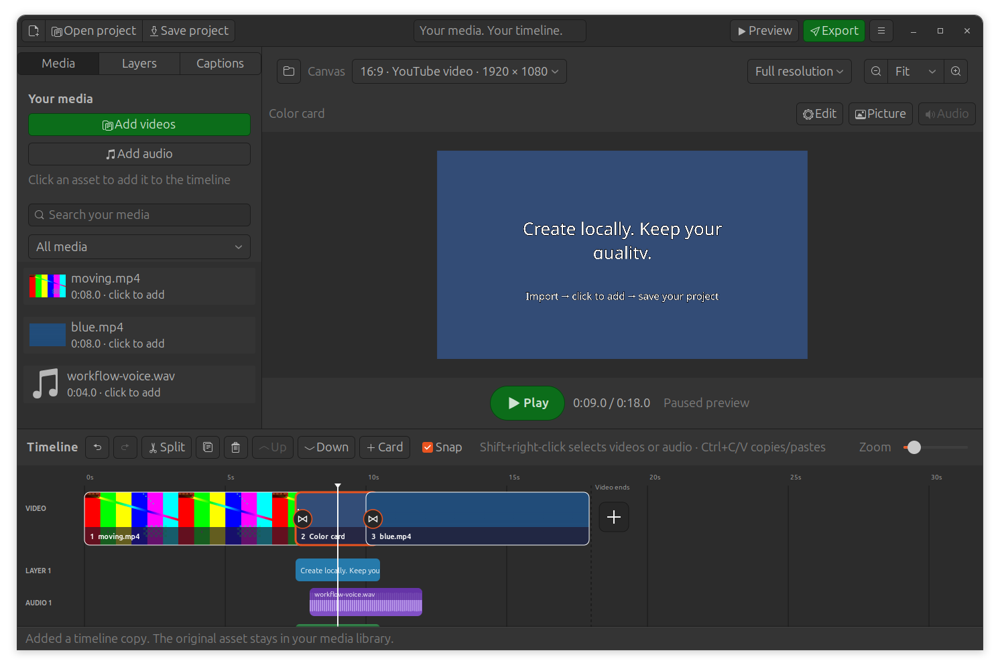

# ClipCanvas 0.25.1

A fast, offline desktop video editor for Ubuntu. Pick a canvas, arrange clips, add transitions, captions, color grades, and audio layers, and export—with no account, cloud upload, subscription, or watermark.

> **Platform status:** Native Ubuntu 24.04 app (GTK 3 + FFmpeg). Windows support is planned; no Windows installer is available yet.



---

## Install on Ubuntu

1. Download [`clipcanvas_0.25.1_all.deb`](installers/ubuntu/clipcanvas_0.25.1_all.deb) ([SHA-256 checksum](installers/ubuntu/SHA256SUMS.txt)). On GitHub, use **Download raw file**.
   *(Recent CI builds are also available under [GitHub Actions artifacts](https://github.com/lixonic/clipcanvas/actions) for 14 days.)*
2. Double-click the `.deb` file in your software installer, or run:

   ```sh
   sudo apt install ./clipcanvas_0.25.1_all.deb
   ```

3. Launch **ClipCanvas** from the Ubuntu applications menu (or run `clipcanvas`).

First-time installation fetches standard Ubuntu dependencies (GTK 3, GStreamer, FFmpeg). After that, editing and exporting work completely offline. Automatic captions perform a one-time local speech model download.

To uninstall later, use Ubuntu's app manager or run `sudo apt remove clipcanvas`. Your media, projects, and exports remain untouched.

---

## Key Features

- **Flexible timeline & media library:** Landscape (`16:9`), portrait (`9:16`), and square (`1:1`) canvases with automatic source FPS. Mix videos, images (with optional slow zoom), and solid color cards; drag to reorder, trim edges, snap, split (`S`), and batch-edit multi-selected items.
- **Picture, crop & color grading:** Click the preview to pan and zoom/crop (`100–400%`) directly with the mouse, rotate/flip, add picture fades, desaturate, or apply cinematic color presets and exposure/tone/saturation adjustments. Includes multi-pass visible Gemini sparkle watermark removal for 720p/1080p footage.
- **Manual watermark repair:** Right-click a video clip and choose **Mark watermark region…**. Draw a box around a stationary mark, compare the repaired frame, then apply it to the clip. Split the clip first for a mark visible during only part of a shot.
- **Transitions & visual layers:** 9 illustrated transitions (including **Apply to all clips**), plus text titles, logos/images, and video overlays with entry/exit animations, opacity, stacking controls, and attached sound cues.
- **Multi-lane audio & voice effects:** Layer WAV (16/24-bit PCM, 32-bit float), MP3, and other audio across multiple lanes with draggable fades, group volume/mute, audio extraction, pitch-preserving speed (`0.25×–4×`), and built-in voice effects (Amplify, Tone/EQ, Echo, Compressor with A/B audition).
- **Offline speech captions:** Generate word-timed captions locally with automatic language detection or a dedicated **Malayalam** model (with bundled *Noto Sans Malayalam*, *Manjari*, and *Anek Malayalam* fonts). Includes spoken-word yellow highlights, reusable cross-project style presets, and SRT import/export.
- **Live preview & fast export:** Stream full compositions—including multi-hour timelines with transitions, captions, and sound effects—using bounded picture/audio windowing and selectable **Full / HD / Fast** preview resolutions. Export to **Maximum quality MP4** (with Fast, Balanced, or Efficient speed presets and optional VAAPI hardware encoding) or **Lossless master MKV**.
- **Safe local projects:** Projects save as `.clip` files (existing `.clipcanvas` files still open and save in place). Originals are never modified. Includes 30-second crash recovery, missing-media relinking, and **Save portable copy** to bundle a project with its media.

---

## Quick Start

1. **Choose a canvas & import media**
   Select **16:9**, **9:16**, or **1:1** above the preview. Click **Add videos**, **Add images**, or **Add audio** in the sidebar, then click any thumbnail tile to append a copy to the timeline.
2. **Arrange & trim clips**
   Drag clips to reorder them, drag clip edges to trim, or move the playhead and press **S** to split. Use **+ Card** to insert solid color scenes, or **Edit → Motion** on image clips for slow zoom.
3. **Crop, color & clean up picture**
   Left-click the video in the preview to drag-position or corner-zoom your crop (**Enter** or **Done** to apply). Use **Picture** or **Color** for rotation, fades, desaturation, and cinematic grades. Right-click video clips and choose **Remove watermark** to patch detected Gemini sparkles.
4. **Add transitions, layers & captions**
   - **Transitions:** Click the round join button between two clips to choose an effect and duration (or apply it to all joins).
   - **Layers:** Open **Layers** in the sidebar to add text, logos, or overlay videos; drag them on the canvas to position.
   - **Captions:** Open **Captions → Generate captions** (select **Malayalam · മലയാളം** if needed), then edit wording, timing, or style presets—including spoken-word **Highlight**.
5. **Mix audio & voice effects**
   Drag audio clips across lanes or drag their waveform fade handles. Right-click any audio or video clip for **Audio → Volume and fades…**, **Extract audio**, or **Voice effects…**.
6. **Preview & export**
   Press **Space** to play/pause or drag the playhead to scrub. Switch the preview selector above the canvas between **Full resolution**, **HD preview**, and **Fast preview** as needed—exports always render from your original files at full canvas resolution. Click **Export** to save an **MP4** or **Lossless master MKV**.

---

## Keyboard & Mouse Shortcuts

| Action | Shortcut |
|---|---|
| Play / Pause | `Space` |
| Split selected clip or audio at playhead | `S` |
| Undo / Redo | `Ctrl+Z` / `Ctrl+Shift+Z` |
| Save / Save as / Open project | `Ctrl+S` / `Ctrl+Shift+S` / `Ctrl+O` |
| Select all / Range / Toggle item | `Ctrl+A` / `Shift+Click` / `Ctrl+Click` |
| Select all items of same type (video or audio) | `Shift+Right-Click` |
| Copy / Cut / Paste / Delete selection | `Ctrl+C` / `Ctrl+X` / `Ctrl+V` / `Delete` |
| Zoom timeline (over timeline) or preview (over canvas) | `Ctrl+Wheel` |
| Pan zoomed preview | `Shift+Drag`, middle-drag, or scroll/trackpad |

---

## Good to Know

- **Originals stay safe:** Edits are non-destructive; exports always read your original media at the project canvas size.
- **Overlay timing:** Layer, caption, and soundtrack timestamps stay fixed when you move or resize base clips—double-check their alignment after rearranging the main sequence.
- **Heavy timelines:** Live preview computes effects on the CPU. If playback stutters, switch to **HD/Fast preview** or use **Project → Render smooth preview…**.
- **Scope:** Focused on local editing—no stock library, cloud templates, collaboration, caption translation, or animated GIF layers.

---

## Run or Build from Source

ClipCanvas uses Ubuntu's system Python (`/usr/bin/python3`) with GTK 3, GStreamer, and FFmpeg (see [`CONTRIBUTING.md`](CONTRIBUTING.md) for the exact `apt` dependency list and test instructions).

```sh
# Run directly from the repository
/usr/bin/python3 -m clipcanvas

# Build a .deb installer and source archive (no sudo required)
/usr/bin/python3 build_deb.py --output-dir ./dist
```

Released under the MIT License ([`LICENSE`](LICENSE)).

---

## Documentation

- **Release history & roadmap:** [Changelog](CHANGELOG.md) · [Feature status](docs/CANVA-FEATURES.md) · [Development plan](docs/DEVELOPMENT-PLAN.md) · [Contributing](CONTRIBUTING.md)
- **Editing guides:** [Workflow & shortcuts](docs/EDITOR-WORKFLOW.md) · [Image clips](docs/IMAGE-CLIPS.md) · [Transitions & animations](docs/EFFECTS.md) · [Color grading](docs/COLOR-GRADING.md) · [Desaturation](docs/DESATURATION.md) · [Captions](docs/CAPTIONS.md) · [Audio lanes](docs/AUDIO-LANES.md) · [Voice effects](docs/VOICE-EFFECTS.md)
- **Preview & export details:** [Live preview & cropping](docs/LIVE-PREVIEW.md) · [Preview buffering & cache](docs/PREVIEW-BUFFERING.md) · [Quality & color cards](docs/QUALITY-CARDS.md) · [Export speed](docs/EXPORT-SPEED.md) · [Hardware encoding (VAAPI)](docs/HARDWARE-EXPORT.md) · [Export memory](docs/EXPORT-MEMORY.md) · [Source color range](docs/COLOR-RANGE.md)
