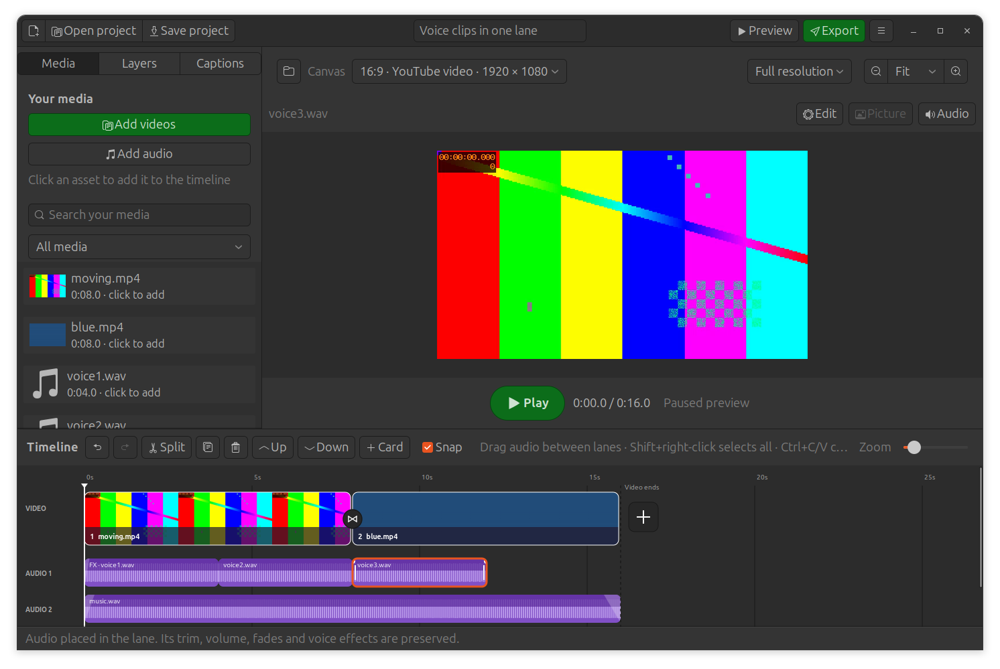

# Shared audio lanes — ClipCanvas 0.9.2

An audio lane holds several clips in sequence. Clips keep independent source
trim, speed, volume, fades and voice effects. Music can play on another lane
while several voice clips play one after another in a single Voice/Audio lane.

## Place clips in a lane

1. Drag a waveform by its body, away from its trim/fade handles.
2. Move horizontally to choose the time and vertically to choose an Audio lane.
   With **Snap** enabled, the start aligns to other clip boundaries nearby.
3. The waveform lifts under your pointer. **Drop here** marks the destination.
   Release to place it; **Ctrl+Z** restores the prior lane/time in one step.

Clips in one lane must not overlap. The destination turns red on a conflicting
drop, which leaves the timeline unchanged. For simultaneous voices or background
music, use another Audio lane, or drag to **new lane** below the final row.
Moving vertically without horizontal movement preserves the exact start time.

For precise placement, right-click → **Move to audio lane**. Each destination
says **keep time** when there is room, or **after last clip (time)** when it would
otherwise overlap. The latter joins the clips end to start. **New audio lane**
keeps the time. **Edit → Timing** still sets exact source/time/speed values;
an edit that would overlap a clip in the same lane is rejected.

Audio beyond the main video end remains visible but is excluded from playback
and export. Arranging longer narration does not automatically extend the video.

## Other operations

- **Split:** both parts remain in the original lane, independently editable.
- **Up / Down:** moves the entire lane's display position, preserving timing.
- **Delete:** removes selected clips; a lane disappears only after its last clip.
- **Duplicate:** creates a separate lane at the same time, keeping both visible.
- **Copy / paste:** preserves relative times, effects and copied lane groups.
  A free interval can reuse the source lane. If any copied clip would overlap
  existing audio, that copied lane group gets a separate lane at the same times.
- **Click an audio asset:** creates a copy at the playhead. It joins the selected
  Audio lane when it fits, otherwise starts a separate lane. Originals stay in
  the media library.
- **Shift+right-click audio / group volume:** still selects all audio clips,
  including those sharing lanes. Volume remains a property of each clip.

## Projects and validation

Format 6 stores stable audio lane IDs separately from individual clip IDs.
Opening formats 1–5 preserves each previous audio row, timing and effects.
Deleting a lane's first clip does not change its identity or saved row order.
Projects saved by this release require ClipCanvas 0.9.2 or newer.

Regression checks cover vertical dragging, live drop previews, collision
rejection without history changes, new-lane drops, menu appending, split,
duplicate, Up/Down, delete, undo/redo and save/reopen. Model checks cover
trim/speed-aware boundaries, clipboard grouping and format-5 migration.
A render check compares actual WAV outputs before and after a lane-only move;
they are byte-identical, including fades, echo and a simultaneous soundtrack.

