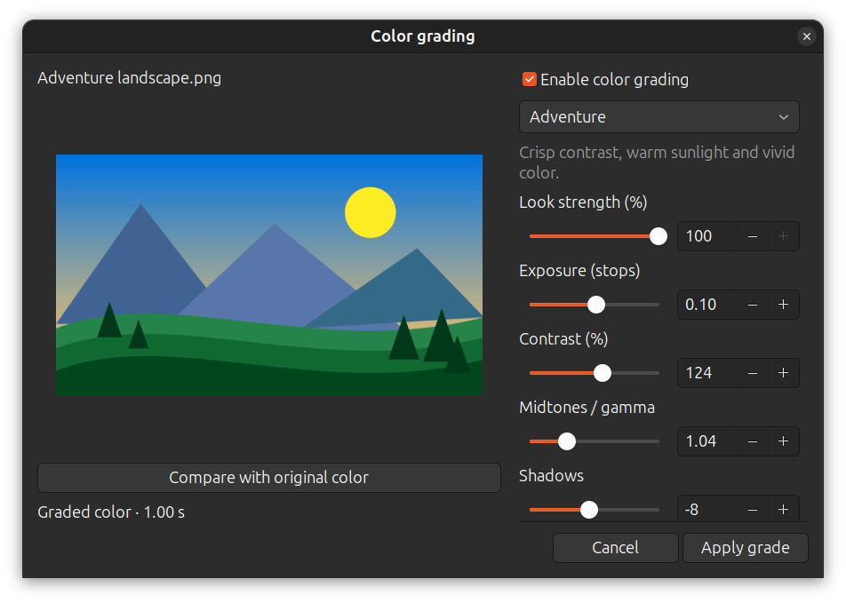

# Color grading — ClipCanvas 0.14.0

Selected features: **C39** (filter presets and strength) and **C40** (primary
color/light adjustments). The requested outcome is an editable, Resolve-inspired
clip grading feature with animated/Pixar-inspired, horror, adventure, romantic
and mystery movie presets.

Select a timeline video, image or color card and click **Color**, or right-click
and choose **Color grading…**. Choose a starting look:



| Preset | Starting appearance |
|---|---|
| Pixar-inspired animation | Bright, rich color, warm midtones, gentle highlights |
| Horror | Dark, desaturated, cold and slightly green |
| Adventure | Crisp contrast, warm sunlight, vivid color |
| Romantic | Soft contrast, lifted shadows, warm rosy color |
| Mystery | Cool, muted color, deeper shadows, restrained highlights |

Neutral, Warm, Cool, Soft and Punchy are also available. These are creative
starting looks rather than studio LUTs; grading alone does not turn live-action
footage into animation. Source lighting, exposure and color influence the result.

**Look strength** blends each primary adjustment toward its neutral value from
0–100%; 0% shows original color. Adjust exposure (−3 to +3 stops), contrast,
midtones/gamma, shadows, highlights, temperature, tint and saturation (0–200%).
The preview updates after a short pause while dragging, without committing an
edit. The composition includes transitions and overlays at the chosen clip time.
**Compare with original color** temporarily removes that clip's color adjustments;
**Enable color grading** bypasses the grade while retaining its settings.
**Reset all color adjustments** returns every slider and saturation to neutral.

Press **Apply grade** to save one undoable edit. If several timeline clips are
selected, optionally enable **Apply to all selected clips** to replace their
individual color settings with the displayed grade. Other selected item types
are ignored. Cancel or closing the dialog keeps the previous project settings.

Timeline thumbnails show the applied look and a **COLOR** marker. Grading happens
on each source before fit borders, transitions, titles, captions and logos, so
borders remain black and overlays retain their own colors. Audio and original
media files remain unchanged. Live playback, native scrubbing, prepared previews
and exports use the same primary adjustment model. GTK and FFmpeg decoding,
scaling and RGB/YUV rounding can differ slightly in previews.

Grades survive save/reopen, recovery, split, duplicate, copy/paste and portable
collection. Missing settings are neutral; existing desaturation projects keep
their prior appearance. The project format stays at 8, but rendering these grades
requires ClipCanvas 0.14.0 or newer. This is an SDR primary grading tool; it does
not include nodes, secondary masks/tracking, curves, imported LUTs, scopes, HDR
color management or keyframed grades.

## Repeatable visual check

1. Add a colorful video, photo and color card, with a title/logo above them.
2. Open **Color**, try each of the five cinematic presets, then vary look strength
   between 0%, 50% and 100%. Compare original color and toggle grading off/on.
3. Change exposure, gamma, shadows/highlights, temperature and tint. Confirm the
   preview stays responsive while sliders move. Reset, then cancel; confirm the
   timeline and saved settings retain their prior state.
4. Apply a preset; scrub and play the clip. Check its thumbnail, colored overlays
   and black fit borders. Check a transition between two different grades.
5. Select multiple clips, enable the group checkbox and apply a look. Undo and
   redo once; confirm all selected clips restore their own previous settings.
6. Split/duplicate a graded clip, save/reopen and check the settings. Open an
   older project and confirm its original appearance.
7. Export MP4 and a lossless master, compare with playback, and check that audio,
   timing and original media are preserved.

## Automated validation

`tests/test_color_grading.py` uses generated footage, photos and cards to check
distinct cinematic looks, expected control behavior, 0/50/100% strength, bypass,
native/live/lossless agreement, audio, transitions, overlays, fit borders,
source hashes, alpha/row padding, selection, split, clipboard and save/reopen.
Invalid settings are rejected, including disabled grades with malformed values.
`tests/test_color_grading_ui.py` exercises the actual GTK presets, asynchronous
preview, A/B comparison, bypass/reset, cancellation, group apply, no-op apply,
Undo/Redo and saved settings.

```sh
/usr/bin/python3 -m unittest discover -s tests -p 'test_color_grading*.py' -v
```

The GTK checks require a working desktop display or Xvfb. All media are synthetic;
no network, user media or studio footage is needed.

Focused validation on 31 October 2026: all eight grading/rendering and native
GTK checks pass. The native panel was visually inspected using the generated
landscape above. Installer/source contents, version and desktop launcher were
also checked. The existing playback-buffering test race reproduced on unmodified
0.13.1; its assertion now waits for the asynchronous pause to finish.
