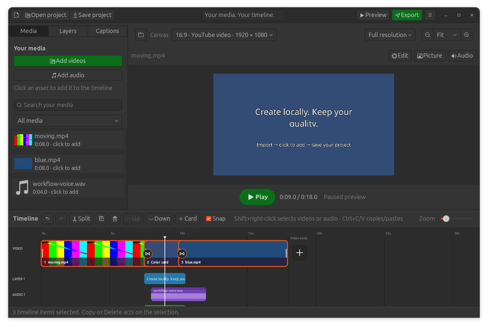
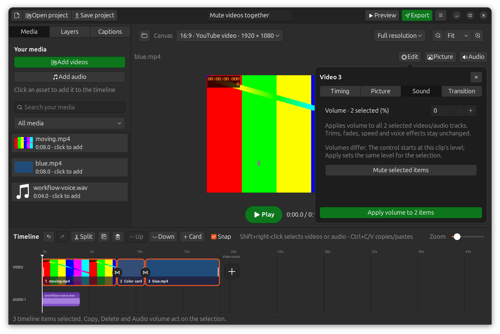

# Desktop workflow — ClipCanvas 0.9.1

## Import, then place

**Add videos**, **Add audio**, the end-of-timeline plus, and dropping local files
import into **Your media**. They leave the timeline and current preview alone.
Click a library asset to create an independent timeline copy: video appends to
the main sequence, audio starts at the playhead, and a dropped image becomes a
positioned layer. Clicking again creates another copy; editing/deleting it does
not edit/delete the source asset. Explicit Layers → Add image/overlay actions
create the requested layer and also retain its source in Your media.

The library deduplicates imported files by path/type and is searchable/filterable.
Unused imported assets are saved, recovered and collected in portable copies too.
A missing unused library file does not prevent exporting available timeline media.
Relink missing media updates its library and timeline references.

## Selection and shortcuts

| Control | Result |
|---|---|
| Click a timeline item | Select that item |
| Shift+click | Add the range from the previous selected item, within that kind |
| Ctrl+click | Toggle an individual item, including across video/audio/layers/captions |
| Shift+right-click video | Select all main-sequence videos/cards and open their menu |
| Shift+right-click audio | Select all audio tracks and open their menu |
| Ctrl+A | Select the complete timeline, including layers and captions |
| Delete | Remove selected items together; the library remains |
| Ctrl+C / Ctrl+X | Copy / cut selected timeline items |
| Ctrl+V | Paste copies at the playhead |
| Ctrl+Z / Ctrl+Shift+Z | Undo / redo |
| Ctrl+wheel over timeline | Zoom time scale around the pointer |
| Ctrl+wheel over canvas | Zoom the preview independently |
| Space | Play / pause |
| Ctrl+S / Ctrl+Shift+S | Save project / Save as |
| Ctrl+O | Open project |

Copy/paste preserves media, trim, effects, opacity and text. Pasted items receive
new IDs and independent settings. Audio/layers/captions retain their relative
start offsets from the earliest copied item. Main-sequence clips insert at the
next scene boundary at/after the playhead; the main sequence closes gaps.
Groups delete/cut/paste in one undo step. Group volume is available too:
**Shift+right-click → Mute selected videos** sets all selected video volumes to 0.
Choose **Volume for N selected items**, enter a percentage, and use **Apply volume
to N items** to set any shared level. In a group Sound panel, only volume changes;
source trims, timing, speed, fades, picture properties and voice effects stay as
saved for each item. Cards, text and image/video overlays have no sound control.
Video-only selection leaves independent soundtracks untouched. Ctrl-selection
can include both video and audio tracks, and Shift+right-click audio selects only
soundtracks. A group change has one undo step and persists in a saved project.
**Unmute selected** restores prior positive levels remembered during the current
app session, or normal volume when there is no remembered level.
Dragging, Duplicate and other property commands still operate on the primary item.
Entries, text editors and numeric fields keep their own copy/paste/select/delete
shortcuts. Context menus also handle Delete and clipboard shortcuts.

## Remembered settings

Native file pickers remember folders only after **Accept**, not Cancel. Media,
project and export folders are remembered separately, with the most recently
accepted folder as fallback. A deleted folder falls back to a valid recent folder
or Home. Settings survive app restarts in the desktop config directory
(`$XDG_CONFIG_HOME/clipcanvas/preferences.json`, normally `~/.config/clipcanvas`).

Applying Voice effects remembers echo, gain, tone and compressor values. A track
without configured effects opens with these values next time; it requires
**Apply effects** to add them. Existing configured tracks show their own settings.
Cancel and audition do not change remembered values. Neutral resets the editor
controls; Apply keeps that choice as the new default.

Applying volume/fades remembers those values too. **Audio → Use last volume and
fade settings** loads them into the controls of another item; **Apply changes**
commits them. New tracks start at normal volume; a remembered setting never
silently changes their sound.

## Save and resume

Labelled **Open project** and **Save project** are in the top bar. The project menu
also has **Save project as**, portable collection, relinking and crash recovery.
`.clipcanvas` files save the library, sequence, audio mix/effects, text, overlays,
captions/styles, canvas and timeline row order. Originals remain separate local
files; collect a portable copy before moving between computers.

Project format 5 migrates formats 1–4. Projects saved by 0.9 need 0.9 or newer.
If upgrading an open app, save your work, close it and reopen ClipCanvas to load
the new installed code.

## Preview timing and validation

Play/Pause now has a large labelled primary button below the preview. Live
playhead notifications accompany displayed decoded frames, and Pause discards
queued frames. Silent dragging seeks into the current clip at aligned source and
composition frame boundaries, preserving picture fades and transition overlap.
Full/HD/Fast only change preview resolution; export reads original sources.

91 local automated checks pass, including 19 native GTK workflows and real offline
speech recognition. Added checks cover library-only imports followed by actual
asset clicks, group selection/Delete/undo, clipboard identity/timing/effects,
text-field shortcut isolation, separate wheel zoom, accepted-folder restoration,
cancel/apply persistence, project/library collection/migration, presented-buffer
playhead time, and deep scrubbing through speed, fades, overlays and transitions. The group-volume
regression selects a non-first video, applies 0% via the real popup, checks all
selected video levels and untouched soundtrack/other properties, then exercises
undo/redo, menu mute/unmute, save/reopen and mixed video/audio selection.

A local 640×360 moving source scrubbed at 6.5 seconds averaged 219 ms before and
175 ms after aligned seeking (three reads each on this machine). This measures
one frame computation, not guaranteed pointer-to-screen latency. FFmpeg startup,
keyframe spacing, project resolution, layers and CPU affect responsiveness;
hardware decoding and a persistent seek cache are future work.

Manual native QA also confirmed Full 1920×1080 frames, actual library-button
placement, group highlighting, save/reopen and zero difference between the
reported live frame time and the playhead during a one-second Fast playback sample.

