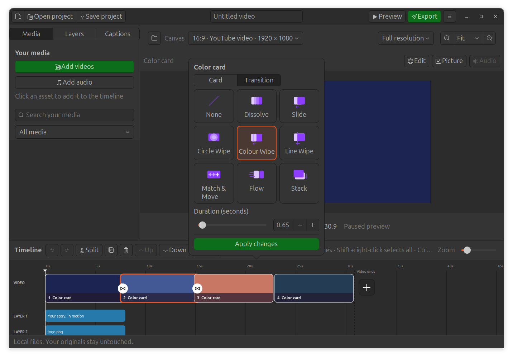
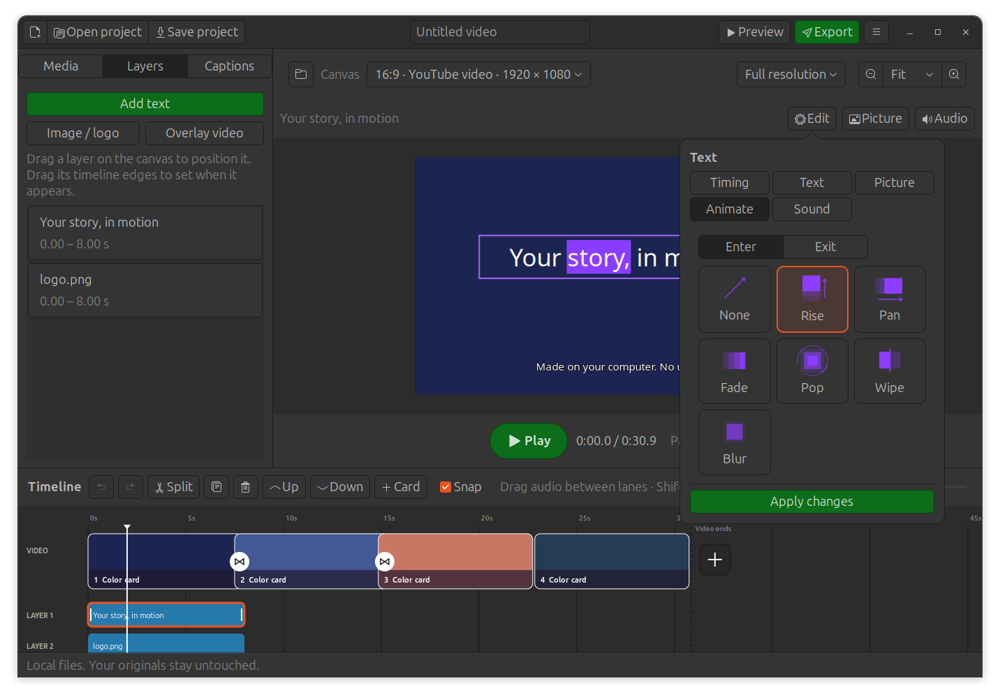
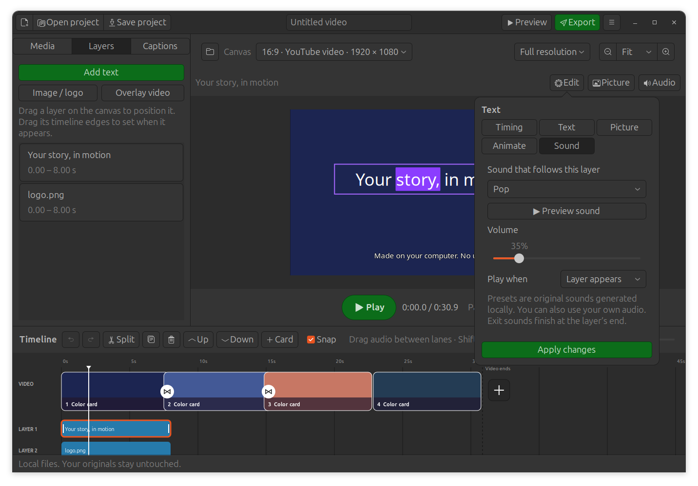

# Transitions, element animation and sound — 0.10.0

Click the circular button between clips to open the illustrated transition
picker. Choose a tile, set the duration and press **Apply changes**. Applied
joins use the white bowtie icon; hovering an unused join shows a plus. The
tooltip identifies the effect. Cards use the same picker.

| Choice | ClipCanvas behavior |
|---|---|
| None | Cut directly to the next clip |
| Dissolve | Fade one scene into the next |
| Slide | Push both scenes left, right, up or down |
| Circle Wipe | Reveal the incoming scene through an expanding circle |
| Colour Wipe | Sweep a page of the chosen colour between the scenes |
| Line Wipe | Reveal the incoming scene behind a moving coloured line |
| Match & Move | Dissolve the background and tween matching editable layers |
| Flow | Ease moving scenes through a crossfade |
| Stack | Slide the incoming scene over the stationary outgoing scene |

Direction and colour appear only when the selected transition uses them.
Transitions overlap neighboring clips, shortening the overall video. The
actual overlap is limited to half of each neighboring clip. Older project's
wipe/slide/random-dissolve choices keep their original behavior on load.

## Animate text, logos and other visual layers

Select a title, image, overlay video or caption. Open **Edit → Animate**, or
right-click its timeline item and choose **Animation…**. The **Enter / Exit**
selector gives each edge its own effect: **Rise, Pan, Fade, Pop, Wipe, Blur** or
**None**. Set duration and direction, then **Apply changes**. Entry/exit lengths
automatically fit within half the element's interval so they do not collide.
**Clear animations** removes motion while preserving wording and appearance.

Titles and captions also have **Reveal, Highlight, Snake** word effects, with
an editable accent colour. Reveal adds words through the interval; Highlight
marks the active word; Snake accents and underlines it. **Text** still edits
the complete wording, font and the four existing appearance presets. On a
caption, **Apply animation to all captions** copies the chosen motion to every
cue in one undo step. Individual wording and timing stay editable.

Word timing is evenly spread through the element's interval. Speech generation
currently provides caption intervals rather than individual word timestamps;
these effects are not yet word-aligned karaoke recognition. Group animation,
custom drawn paths and Canva's automatic recommendations remain future work.

## Match & Move with editable elements

Create corresponding text or image layers in neighboring scenes and give both
the same **Match key** in Animate, such as `main-title` or `logo`. They must have
the same text/style or image path. End the outgoing layer at its scene's end
and start the incoming layer at the beginning of the overlap. Choose **Match &
Move** at that clip join. Position, size, rotation and opacity move between the
two placements; the incoming duplicate is suppressed during the join.

For example, two 2-second scenes with a 0.5-second transition place the first
title at `0–2 s` and its matching copy at `1.5–3.5 s`. Put the first at 25%
horizontal position and the second at 75%; the title moves across the overlap.
Without a matching pair, this transition dissolves the background.

Canva's [transition description](https://www.canva.com/features/video-transitions/)
and the supplied screenshots guided the workflow. ClipCanvas has original
illustrations and local implementations; proprietary transition algorithms
are not claimed to be identical. Editable element identities cannot be
recovered from objects baked into a video file.

## Attach a sound to a text or image layer

Select the layer and open **Audio / Sound**, or right-click → **Layer sound…**.
Choose **Pop, Crisp pop, Click, Whoosh**, or **Choose local sound…** for your own
WAV/MP3 or another supported audio format. Set volume and **Layer appears /
Layer disappears / Both**. **Preview sound** auditions the selection locally;
**Apply changes** stores it with the layer. Caption cues also support sounds.

Sounds follow the layer when its timing changes, and stop at its end or the
video end. Exit sounds start early enough to finish when the element disappears.
The four presets are original deterministic waveforms generated by ClipCanvas,
covered by the project's MIT license. No Canva library samples are included.
Own-file sounds are collected/relinked with the project's other media.

Many cues are mixed in small blocks into one temporary float PCM track. Each
unique custom sound is decoded once, preserving headroom for the existing final
limiter. This avoids hundreds of audio decoders and late-cue delay buffers.
The temporary track uses disk space, about 92 MB for four minutes at stereo
48 kHz float PCM, and is removed after rendering/playback closes.

## Saving, preview and validation

Format 7 saves all these settings and reads formats 1–6. Reopening, recovery
and portable collection retain editable text, effect choices and sound files.
Older app versions cannot read newly saved format 7 projects. Keep an older
project copy if you need to open it with an older installer.

Preview/export use the same saved effects. Ordinary scrubbing uses full-size
native decoding and the shared Cairo layout; overlaps and video overlays use
the FFmpeg composition renderer. See [seek performance](SEEK-PERFORMANCE.md)
for measurements and limits. Resolution and export quality remain user choices.

Validation uses generated media: all nine clip choices, seven distinct join
patterns, direction/colour variations, real preview/export frames, six entry/
exit motions, three word animations, Malayalam text, matched geometry, attached
audio seeking and trimming, native editing/undo, relinking, recovery and
portable source protection. A 200-caption test with 400 sound events verifies
one added audio input and less than 4 MB of Python allocation during premixing.

As of 0.10.2, Circle Wipe, Colour Wipe, Line Wipe and Flow use native compositing
in live playback, composed scrub frames and exports. Lossless geometry masks
are reused on disk, without reducing source resolution. See
[transition performance and limits](TRANSITION-PERFORMANCE.md).

Version 0.10.3 keeps animated text/caption playback from starving the live audio
stream by replacing interpreted per-pixel opacity, wipe and blur processing with
native operations. Sound files and settings are retained. See
[animation/audio validation](ANIMATION-AUDIO.md).
