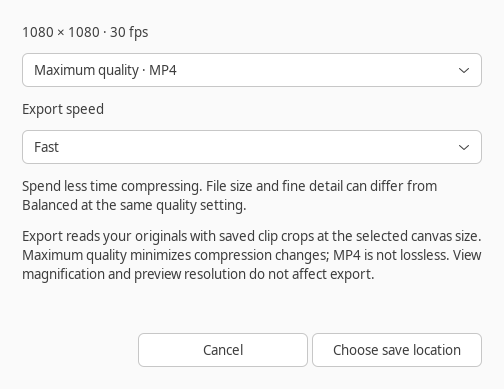

# Export speed — 0.19.0

Selected scope: **X08** and **C55**. The intended outcome is to shorten full-video
exports with independent speed controls and a measured CPU filter budget.

## Choose speed and quality

The export dialog keeps the existing Maximum/High/Smaller MP4 quality choices
and adds a separate speed selector:



| Speed | H.264 preset | Behavior |
|---|---|---|
| Fast (default) | `veryfast` | Spend less time compressing |
| Balanced | `medium` | Use the previous export compression preset |
| Efficient compression | `slow` | Spend more time on compression efficiency |

Quality still selects CRF 14, 18 or 23, respectively. Equal CRF values across
presets do not guarantee equal visual quality or a particular file size.
Choose Balanced when comparing with the previous MP4 output. Maximum remains
the default quality. MP4 continues to use H.264, YUV 4:2:0 and 320 kbit/s AAC.
FFmpeg documents [libx264's preset and CRF controls](https://ffmpeg.org/ffmpeg-codecs.html#libx264_002c-libx264rgb).

The last MP4 speed is remembered after both the export dialog and save location
are accepted. Cancelling either dialog leaves the preference alone. An invalid
saved choice falls back to Fast; a read-only preferences directory does not block
export. Speed is a desktop preference, separate from saved projects and Undo.

Lossless masters retain FFV1 video and floating-point PCM audio. Their speed
selector is disabled, and exporting a master does not replace the remembered
MP4 choice. Prepared previews retain their ultrafast encoder and existing
one-filter-worker budget regardless of MP4 export preferences.

## Rendering budget and limits

Full exports allow at most two filter workers, or one when only one CPU is
available. Each source decoder still uses one thread, and the encoder still
uses at most four threads. This avoids multiplying a machine-sized decoder
pool across every timeline input. The composition graph, source reads, grading,
crops, frame rate, transitions, captions, audio mix and project format are
unchanged. Preview decoders are still released before export. Files are written
to a temporary destination and published only after successful completion;
cancellation preserves an existing destination and original media.

This release uses software encoding. GPU encoding, reusable rendered sections,
parallel segment rendering and stream-copy shortcuts remain separate work.
The whole composition is still one graph; there is no fixed total RAM cap.
More complex filters can remain the bottleneck even when H.264 encoding is fast.
See [export memory](EXPORT-MEMORY.md).

## Measured full exports

Measured on 5 November 2026 with FFmpeg 6.1.1 and an Intel i3-10110U
(two cores/four logical CPUs). Both fixtures use a 1080×1080/24 fps canvas
and Maximum MP4 quality. Times are the median of two complete exports with
reversed case order, after the regression suite had finished.

| Settings | Graded cuts, 4.5 s timeline | Crops/transitions/title/caption/echo, 4.0 s timeline |
|---|---:|---:|
| Previous: medium, one filter worker | 4.964 s | 5.640 s |
| Fast: veryfast, two workers | **3.356 s** | **4.055 s** |
| Balanced: medium, two workers | 4.262 s | 4.794 s |
| Efficient compression: slow, two workers | 5.699 s | 5.521 s |

Fast took 32.4% and 28.1% less time, respectively. Balanced retained the previous
compression preset while taking about 14–15% less time. Fast's sampled FFmpeg
peak RSS fell from 422.03 to 306.29 MiB on the cut fixture and from 558.66 to
447.12 MiB on the layered fixture. Its smaller encoder buffers help explain
this reduction; there is no general memory guarantee.

All speeds retained the complete video duration, canvas and frame rate. This
is a comparison at equal CRF, not a quality-matched encoder comparison. Small
generated timelines do not predict a particular project's speedup or RAM use.

## Repeatable validation

```sh
PYTHONPATH=tests /usr/bin/python3 -m unittest test_export_speed test_export_speed_ui -v
/usr/bin/python3 tools/benchmark_export.py --output /tmp/export-graded.json
/usr/bin/python3 tools/benchmark_export.py --layered --output /tmp/export-layered.json
/usr/bin/python3 tools/benchmark_export.py --project /path/to/project.clipcanvas --output /tmp/export-project.json
```

Run without competing CPU-heavy work. The benchmark uses the real export
function with Maximum quality. Its legacy case selects Balanced and overrides
only the filter budget to the previous one worker. The default fixture is three
1.5-second 1920×1080 H.264/AAC clips, Adventure grading and a 1080×1080/24 fps
canvas. `--layered` adds crop positioning, dissolves, an animated title, a
caption and an independent echo soundtrack. Two runs reverse case order;
generated media and exported files are removed afterwards. Existing projects
are read without saving changes. Linux FFmpeg RSS is sampled every 10 ms;
measurements exclude the GTK application and do not establish an overall RAM cap.

Generated-media checks compare MP4 dimensions, complete frame counts, duration
and soundtracks across speeds. Maximum-quality MP4 must stay above 32 dB PSNR
against the lossless composed fixture. Parallel lossless exports must match
every serial-reference picture byte and PCM sample across cuts, fades, Circle
Wipe, Flow and Match Move, with grading, crop, captions and audio effects.
Other checks cover unchanged source hashes/projects, invalid settings, prepared
preview agreement, single-CPU fallback, dialog cancellation, remembered choices,
lossless control state and read-only preferences. The existing suite covers
export cancellation, temporary-file cleanup and releasing preview decoders.

On 5 November 2026 the complete suite ran 240 tests on a virtual X11 display
with an isolated silent PulseAudio sink: 238 passed and two optional speech-runtime
checks were skipped. Python compilation and desktop-launcher validation passed.
The export dialog was also captured and visually checked at 1600×1000.

Manual check: reopen a saved project, select Export, and make one MP4 with Fast
and another with Balanced at the same quality. Check their complete duration,
crop/grade, transition boundaries, captions and narration. Select Efficient
compression, cancel and reopen; the previous confirmed speed should remain.
Choose Lossless master, confirm speed is disabled, then return to MP4 and
confirm the selected speed is retained. Close/reopen the app to check the saved
MP4 preference. Cancel an export and verify the previous destination remains.
