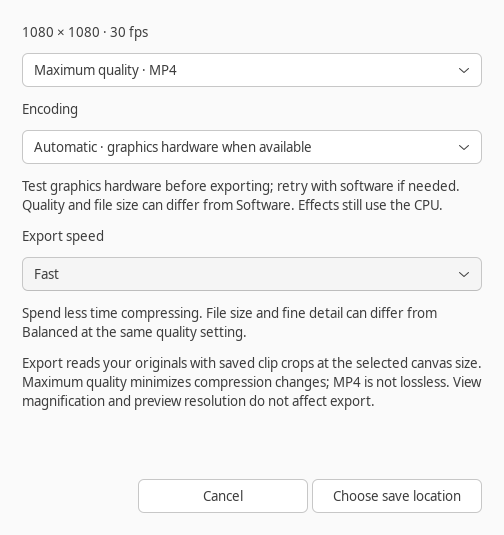

# Automatic hardware export — 0.20.0

Selected scope: **X08** and **C55**. The intended outcome is to reduce full-video
export time using the machine's graphics encoder when it actually works, with
software fallback and the existing original-media/export protections.

## Choose encoding



The export dialog adds **Automatic** and **Software** (default) alongside the
existing quality and speed controls. Automatic tests a Linux VAAPI render node
at the selected canvas size, frame rate, quality and speed before exporting.
It uses an actual two-frame H.264 encode, rather than trusting FFmpeg's list of
compiled encoders. At most four accessible render nodes are tried, with a
four-second limit per probe. Probes and full renders run in the worker and can
be cancelled. No graphics-driver installation or permission changes are made.

If no probe succeeds, the export uses Software. If a hardware render fails,
the same already-prepared composition is retried once in software. Progress
reports graphics/software rendering and any retry. Cancellation never triggers
a retry. If software also fails, the normal error is reported. Existing output
files are replaced only after success, and partial files/probe workers are
cleaned up. No original media or saved project is rewritten.

The last MP4 encoding choice is remembered only after both dialogs are accepted.
Cancelling either dialog keeps the previous choice. Invalid preferences fall
back to Software; read-only preferences do not prevent exporting. Encoding is
a desktop preference and does not change project format 8 or Undo history.

The encoding selector is disabled for Lossless master; FFV1/floating-point PCM
remain its codecs. Prepared previews keep software ultrafast encoding. The
Python render API defaults to `encoding='software'` for existing callers;
the desktop dialog also starts with Software unless you confirm Automatic.

Software remains the default because graphics encoding is not consistently
faster for CPU-heavy compositions or a busy integrated GPU, and hardware files
can be larger. Automatic is an explicit choice, remembered for later exports.

## Picture, audio and quality

Source decoding, cropping, grading, resizing, transitions and visual layers
still use the existing CPU composition graph. Its final YUV 4:2:0 frames are
repacked as NV12, uploaded, then compressed by `h264_vaapi`. The soundtrack
retains the same 48 kHz stereo AAC settings and complete effect history.
Software retry reuses the unmodified original composition graph.

| Control | Software H.264 | Hardware H.264 |
|---|---|---|
| Maximum / High / Smaller | x264 CRF 14 / 18 / 23 | VAAPI CQP 14 / 18 / 23 |
| Fast / Balanced / Efficient compression | veryfast / medium / slow | compression level 7 / 4 / 1 |

CRF and CQP are different scales. Equal numbers do not promise equal visual
quality, bitrate or file size. Driver speed-level support varies. Use Software
for comparisons with 0.19.0 output. Hardware accelerates compression; expensive
CPU filters or storage can still limit total export speed. This is SDR 8-bit
output, separate from HDR/high-bit-depth mastering.

See FFmpeg's [VAAPI encoder options](https://www.ffmpeg.org/ffmpeg-codecs.html#VAAPI-encoders)
and [hardware device setup](https://ffmpeg.org/ffmpeg.html#Advanced-options).
Other hardware backends, GPU decoding/effects, reusable rendered segments and
parallel segment rendering remain separate work.

## Measured behavior on this machine

Three full exports per mode on 6 November 2026 used an Intel i3-10110U with
Comet Lake UHD graphics, FFmpeg 6.1.1, a 1080×1080/24 fps canvas and Fast speed.
Both modes used the named Maximum quality setting. Automatic really used VAAPI,
and its time includes the capability probe. Medians and complete file sizes:

| Generated timeline | Software time | Automatic time | Software file | Automatic file |
|---|---:|---:|---:|---:|
| Graded cuts, 4.5 s | 6.119 s | 4.648 s | 4.33 MB | 7.37 MB |
| Crops/transitions/title/caption/echo, 4.0 s | 9.598 s | 10.342 s | 2.33 MB | 4.08 MB |

Automatic took 24% less time in the graded case and about 8% more in the
layered case. Other desktop applications were active and CPU load varied;
these are observations on a busy machine, not isolated performance guarantees.
The earlier two-run layered comparison favored hardware, reinforcing that
composition and system load affect the result. Hardware files were roughly
70–76% larger here. These are not quality-matched encoder measurements.

This variability is why Software remains the default. Try Automatic on a
representative project, compare its complete render time and output, and keep
the choice that suits that project. The benchmark's memory sampler also now
tolerates a process exiting while its `/proc` status is being read.

## Validation and repeatable checks

The local Intel Comet Lake UHD GPU and installed media driver successfully
encoded actual generated video through VAAPI. Quick Sync initialization failed
on this setup, so this release uses the working VAAPI path. No driver was changed.

```sh
PYTHONPATH=tests /usr/bin/python3 -m unittest test_hardware_export test_export_speed_ui -v
/usr/bin/python3 tools/benchmark_export.py --hardware --output /tmp/export-hardware-graded.json
/usr/bin/python3 tools/benchmark_export.py --hardware --layered --output /tmp/export-hardware-layered.json
```

Run with normal desktop GPU access and without competing CPU-heavy jobs.
The benchmark's `rendering_status` records the path actually used, so software
fallback is not presented as hardware success. Wall time includes the probe.
Both modes use the named Maximum quality setting; this is not a quality-matched
comparison between encoders. Original files/projects are read-only and exports
are temporary. Linux RSS measurements cover FFmpeg, excluding the application
and graphics-device allocations; they are not a total-memory measurement.

Generated checks cover every hardware quality/speed combination, complete frame
counts, dimensions/frame rate, duration, picture fidelity against a lossless
composition and byte-identical decoded AAC soundtracks against software.
Other checks cover no-GPU fallback, a failed partial hardware export followed by
software success/failure, cancellation without retry, probe timeout/cancellation
and child cleanup, source/destination protection, unchanged lossless/preview
output, invalid settings, native dialog choices and remembered preferences.
The real VAAPI check skips only when no working GPU is accessible.

On 6 November 2026 the complete suite ran 250 tests on an isolated X11 display
and silent PulseAudio sink with real GPU access: 248 passed and two optional
speech-runtime checks were skipped. This includes all nine native VAAPI
quality/speed combinations. Python compilation and desktop-launcher validation
passed, and the export dialog was captured and visually checked.

Manual check: export a project with grades, crops, a transition, text/captions
and independent narration using Automatic. Confirm progress reports graphics
hardware, then review the complete ending, transition joins and audio sync.
Repeat with Software at the same quality/speed and compare detail and file size.
Cancel each dialog and an in-progress export; confirm preferences and any
previous output are retained. Toggle Lossless master and back to MP4, then
restart the app to verify the confirmed MP4 encoding preference.
