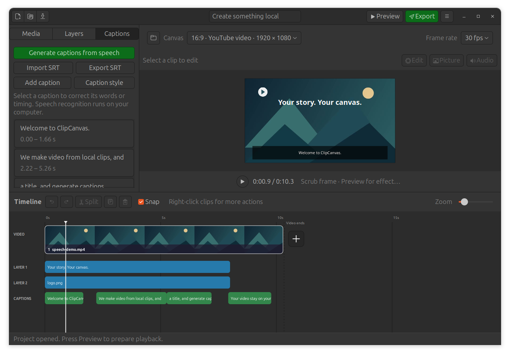

# ClipCanvas 0.4.0 validation

Checked on Ubuntu 24.04 on 10 October 2026, with system Python 3.12, GTK 3,
Pango/Cairo, GStreamer and FFmpeg. Synthetic video, transparent images and a
locally synthesized English speech WAV were used. No private user media was
uploaded or used for recognition checks.

## Functional result

**48 tests passed, none skipped**, including real local speech recognition and
six native desktop workflows. The final full run took 51 seconds on this machine.

```sh
DCONF_BACKEND=memory \
CLIPCANVAS_TEST_SPEECH_RUNTIME=/absolute/path/to/transcription-runtime \
CLIPCANVAS_TEST_SPEECH_AUDIO=/absolute/path/to/speech-check.wav \
/usr/bin/python3 -m unittest discover -s tests -v
```

Without the two optional speech fixture variables, ordinary CI skips the two
real speech checks; it does not fetch models. Headless CI supplies an Xvfb display.
Speech fixtures use the Tiny model. Fresh setup in the installed app's standard
user-data directory also passed. Recognition through the extracted Debian package
used that default runtime offline and produced four editable English cues.

New coverage includes:

- Unicode/multiline titles, transparency, text styles, rotated layout, and shared
  native/export pixel agreement. User text never becomes FFmpeg filter code.
- Image timing and alpha blending, layer order, portrait/landscape canvases,
  preview scaling, and moving overlay source trim/speed/held last frame.
- Caption cue boundaries and gaps, shared appearance and efficient rendering of
  150 cues through a single caption stream rather than one input per cue.
- Original-video recognition audio versus the current mix, including muted
  original speech, 16 kHz mono extraction, cancellation and source-file protection.
- Real Tiny speech recognition with language detection, meaningful timed output,
  word correction and SRT exchange. The desktop job runs setup/readiness, edited
  timeline audio extraction, recognition, correction, title addition and MP4 export.
- UTF-8/BOM/CRLF/multiline SRT, invalid input rejection, atomic writes, media/project
  and hard-link protection. A running worker is cancelled promptly.
- Incompatible runtime markers are rejected; compatible setup returns without
  network access. PyAV 19's actual recognition failure led to the compatible 16.1.0 pin.
- Canvas placement, undo/redo, layer edge trimming, native property controls,
  transparent RGBA style preservation through repeated edits, caption correction,
  project save/reopen and prepared preview composition.
- Format 1/2 migration, format 3 round trips, layer/caption validation, source
  protection, recovery, collection/deduplication and portable project movement.

The pre-existing transition, WAV, pitch-preserving speed, audio extraction/fades,
rotation/crop, recovery, file chooser and clean-preview checks still pass.
Compilation, desktop-file validation and whitespace checks pass separately.

## Visual result

Captured and inspected Yaru-dark and Yaru editor states, titles on the canvas,
caption sidebar/timeline, and text controls. The preview stays clear when the
popover closes. Title controls use native font and alpha-aware color selectors;
GTK 3's lack of #RRGGBBAA parsing is handled explicitly to preserve transparency.

A 1280×720 **client area** fits the editor; window decorations increase its
reported outer size. A 1366×768 client area was also inspected with the text
popover open. Properties can scroll when necessary; the canvas/timeline divider
lets the user give more space to the tracks. Selecting a timeline item reveals
its row. These checks cover this desktop/theme/font scale, not every Linux setup.



## Practical limits

Recognition was validated with generated English speech; Tiny made minor wording
errors which were corrected in the editor. Other languages and difficult real
recordings need user review and further accuracy testing. Small was offered but
not downloaded or benchmarked in this run. Speech runs on CPU, not GPU.

A base video is required. Overlays and cues have absolute timing and do not
ripple when base clips are changed. Overlay video is silent and freezes its final
frame when it runs out. Scrubbing refreshes source/overlay frames and native text;
it does not simulate main-track transitions, fades or mixed sound. Full Preview
renders the composition. MP4 uses H.264/AAC and is not mathematically lossless.

Animated titles/caption packs, word highlighting, translation, image-only
slideshows, Windows installers and deferred provider/API/MCP integration remain
pending. No full Canva or CapCut feature parity is claimed.
