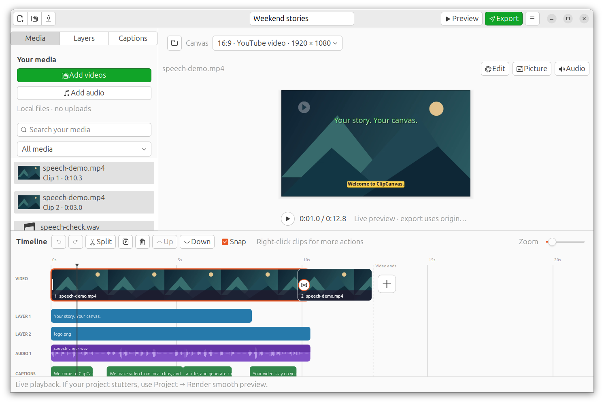
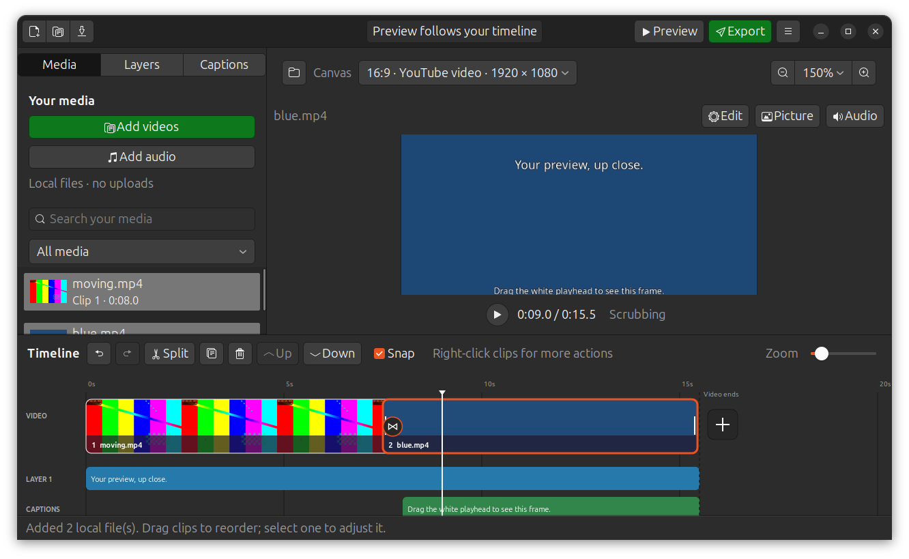

# Live preview, scrubbing and zoom — ClipCanvas 0.11.1

Press **Play**, **Space** or **Preview** to play the composition. It begins once
its first frames are available; it no longer waits for a complete preview MP4.
Pause/resume, playhead/ruler seeking and replay at the end use the native GTK canvas.
After an edit, press play again. No cloud service or upload is involved.

The preview includes clip cuts/transitions, picture/audio fades, trim and speed,
text/caption styles, image/video overlays and opacity, independent soundtrack
placement, voice effects and the final audio limiter. Video overlays remain
silent, as in export. **Full resolution** uses the project canvas by default.
The selector also provides **HD preview** (1280 pixels on the longest edge) and
**Fast preview** (640). No option enlarges beyond the project canvas.
Export still reads the originals at the chosen canvas resolution and quality.
Fast/HD prepare smaller cached main-sequence video sources on first playback,
with visible progress. Later playback and paused seeking reuse them. Full
resolution and all audio processing read the originals. Picture and sound pause
together if decoding runs behind, then resume after buffering. See
[buffering and cache validation](PREVIEW-BUFFERING.md).

## Drag the playhead and zoom the preview

Grab the white playhead line over any timeline row, or drag the ruler. The
preview updates while you move it, including clip transitions, captions and
visual layers. The line and clock follow the pointer immediately; composed
frames can trail it while decoding. Sound pauses during dragging. Release
resumes playback at that position if it was previously playing. If already
paused, the final composed picture stays still without processing the audio mix.

Use the native **− / Fit / +** controls above the preview for 25–400%
magnification relative to the fitted canvas. **Ctrl+wheel** also zooms. When
enlarged, scroll normally to move vertically, or use **Shift+scroll** to move
horizontally. Trackpads support smooth movement in both directions. Scrolling
stops at the picture edges and leaves the playback position unchanged.
**Shift+drag** or middle-button drag also pans within the canvas; **Fit**
centers and shows the complete image again. Zoom remains through playback and
seeking, and resets on new/open/recovered projects. It changes only the preview
view, never the export, saved geometry or undo history. Direct layer placement
continues to use the visible, zoomed canvas coordinates.

The frame worker finishes one composed RGB picture, then takes the newest
pointer time; it does not build a backlog or keep resetting a debounce timer.
It skips completed clips, inactive cues/layers, and audio processing while
retaining the shared visual graph and global timing. The final released time
replaces any older pending picture. Project changes and closing cancel the
worker. There is no prepared video file. Large source frames, deep positions
inside an active clip, and complex overlays can still slow individual updates.

## Automatic frame rate

The FPS dropdown is removed. The first file-backed main video clip supplies its original
average frame rate, including 30000/1001 (29.97) and 60000/1001 (59.94). Mixed-rate
projects need one output rate: later clips follow the first. Reordering/removing
that video clip changes the project rate. Color cards are skipped; a cards-only
project keeps its saved rate (30 for a new project). Speed changes do not change output FPS.
Original FPS is retained with each clip; older projects obtain it from source
metadata when opened, and the render worker probes it again before export.
When metadata is unavailable/unknown, the saved project rate (30 for a new
project) remains the fallback. Variable-rate sources are converted to their
average rate; this is not variable-rate mastering. Rates up to 240 are supported.

## Playback implementation and limits

FFmpeg executes the same composition graph used by export, producing raw I420
video and 48 kHz stereo PCM in a Matroska pipe. GStreamer demuxes and clocks the
audio sink and RGB appsink together. The composition itself streams without a
video/audio encoding step; Fast/HD can first encode reusable, reduced-resolution
source proxies. Text/logo sprites and caption PNG sequences are
still temporary files; those are removed with the producer's workspace.

Appsrc and downstream queues apply backpressure, bounding frame/audio buffering.
Seek, edit, project switch and close cancel the previous generation. Stale frames
and error callbacks cannot replace the new generation. The worker reaps FFmpeg
and removes its temporary workspace. Seeking skips completed main clips while
retaining global layer/caption timing and soundtrack processing history.

Playback is CPU-based. Complex projects can stutter; overlay videos and
soundtrack effect history can take catch-up decoding after a seek. A large set
of caption sprites also adds startup work. GPU acceleration, adaptive proxies,
a media cache and a persistent interactive timeline engine remain separate improvements.
**Project → Render smooth preview…** retains the prepared-file fallback for
projects that cannot keep up. Export still renders the final video.

On-canvas layer dragging briefly uses a source editing frame so the selected
layer can move directly with the pointer. Ordinary ruler seeking uses the
composed frame, including transitions and fades.

## Validation of 0.7.0

The full local suite passes **73 tests**, including **11 native GTK workflows**
and actual local Tiny speech recognition. Generated test media exercises:

- Raw-video/PCM stream codecs, source/project preservation and cancellation.
- Frame and sample equality after seeking into a transition and a later clip,
  retaining captions, title placement, music offset, fades and echo history.
- Video-overlay speed, opacity, rotation and frozen final frame after seeking.
- Original fractional FPS in both the live stream and final MP4, mixed-rate
  first-clip policy, reorder, undo, older-project probing and save/reopen.
- Native play/pause/resume, end/replay, clip selection, delayed asset completion,
  edit cancellation and producer cleanup, with the MP4 renderer forbidden.
- Existing voice effects, WAV mixing, text styles, overlays, captions, extraction,
  transitions, recovery, native file chooser and project portability.

A separate native fixture check measured a first live frame in **0.26 seconds**
on this machine with titles, logo, captions, a soundtrack and the video's own sound.
This is one generated-fixture measurement, not a general performance guarantee.
Rapid seeks retire every producer. Light/dark native captures were inspected;
the FPS selector is absent and the preview is unobstructed. A stray timeline
join outline was also fixed by starting its circle on an independent Cairo path.

Dependencies remain Ubuntu GTK3, GStreamer base/good/libav and FFmpeg. This
release provides an Ubuntu .deb; Windows runtime/installer validation is pending.

## Validation of 0.7.1

The full local suite passes **76 tests**, including **13 native GTK workflows**
and actual local Tiny speech recognition. New checks compare scrub pictures
with uninterrupted playback across cue entries, transitions and later clips,
including video overlays. Whole-frame mean absolute RGB error stays below
3/255; skipping inactive items/completed joins can remove intermediate chroma
rounding. Source projects remain unchanged and cancellation is exercised.

Native checks drag the line inside thumbnails, move continuously while holding
it, cross clip boundaries, reject stale playback positions, retain selection
and clip timing, settle silently when paused, and resume previous playback.
Zoom controls, Ctrl+wheel, pan, Fit, layer positioning and new-project reset
are checked without changing project/history. The continuous-drag check also
passed after the final stale-position guard adjustment.

A separate native fixture check displayed a composed frame at 9 seconds in the
second clip, with a title/caption, in **0.56 seconds** while dragging on this
machine. This is one measurement, not a performance guarantee. Native light
and dark captures were inspected; the installed package is checked separately
with the same fixture.

## Quality and color-card follow-up: 0.8.0

The quality selector applies to live playback, composed scrub pictures, paused
selection pictures and optional rendered previews. It is a per-window view
setting, independent of project geometry, zoom and export; it restarts playback
at the current position when changed. Full resolution can take more CPU and
memory, especially at 4K. There is no hidden quality downgrade: select HD/Fast
when smoothness is more useful than pixel inspection. Native editing frames use
PNG; timeline/library thumbnails remain small for navigation.

Color cards run through the same composition graph with silent audio, transitions,
absolute layer/caption timing and independent soundtracks. A new seek cancels
any obsolete paused-frame request so its callback cannot interrupt the newer
playback. See [quality, cards and validation](QUALITY-CARDS.md).

## Frame timing and source seeking: 0.9.0

The native live canvas reports the timestamp of each RGB buffer presented to GTK,
so its clock label and timeline playhead move with the visible frame. The 100 ms
pipeline-position polling path no longer drives live playback. Pause discards
pending playback buffers; paused seeking still accepts its new preroll frame.

Silent composed scrubbing now input-seeks within the first active source, skipping
whole source/output frame intervals. Picture fades keep the original local time;
transition offsets keep the shortened prefix length. The outgoing overlap and
video-overlay resampling history are retained for accurate join/overlay frames.
Audio/effect history is unchanged in playback and export.

Fast is a resolution setting, not hardware acceleration. Decoding/compositing has
finite latency, especially with many layers or high-resolution sources. See
[workflow validation and timing](EDITOR-WORKFLOW.md). Ctrl+wheel zooms the surface
under the pointer: timeline time scale or canvas magnification independently.

## Display timing and drawing work — 0.9.4

The newest pending RGB picture and its timestamp are now promoted in GTK’s
[frame-clock update callback](https://docs.gtk.org/gtk3/method.Widget.add_tick_callback.html),
before the preview and timeline paint. Previously an idle callback delivered
pictures independently of the drawing cycle. Prepared-file previews also use
the painted picture’s timestamp, without a competing position-query timer.
The pending picture stays bounded to one; pause drops it and a stop/seek clears
its playback generation. No interpolation moves the line beyond a held frame.

During playback the timeline invalidates only 17-pixel strips around the old
and new white-line positions. Thumbnail tiling and waveform bars are limited
to the dirty clip; offscreen clips, captions and joins skip painting. Geometry
and all click, trim, fade and transition targets are still rebuilt. Item drags
and ordinary edits keep their full repaint. Clock labels only change when their
formatted time changes; the player owns its single canvas repaint. There is no
large timeline bitmap cache or additional media render. Export settings and
project timing are unchanged.

The suite has 99 checks, including 22 native GTK workflows. The new native
regression records preview and timeline draw frame counters and verifies that
both paint the same newest picture timestamp in a common refresh, for live and
prepared playback. It also checks coalescing, pause, stale-generation rejection,
and that query clocks cannot move a prepared-preview line independently.

This reduces UI drawing delay; CPU decoding/compositing and display refresh
latency still exist. Full-resolution preview may stutter on complex projects.
HD/Fast remains an explicit preview-only choice and does not change export.

A local Cairo benchmark on 2026-10-12 used a generated four-minute timeline with
40 clips, four waveform tracks and 40 captions, a 1600×440 visible viewport,
and 60 measured redraws after warm-up per mode:

| Timeline scale | Previous full redraw, median | Optimized full redraw | Moving playhead strips |
|---|---:|---:|---:|
| 28 pixels/second | 76.250 ms | 33.395 ms | 2.574 ms |
| 140 pixels/second | 216.943 ms | 28.084 ms | 2.638 ms |

The full visible pixels and all clip/join/fade/add hit targets matched the prior
implementation. Incremental pixels matched a complete repaint exactly at normal
zoom; at higher zoom one antialiased ruler pixel differed by one color level due
to clipping. This measures timeline paint CPU time with generated thumbnails and
waveforms, excluding video decoding, compositor/display latency and audio. It is
not a playback-FPS or pointer-to-preview latency guarantee.

## Starting playback after seeking — 0.10.1

Play now input-seeks the active main video near the playhead, preserving the
composition frame grid, fades and outgoing join. An independent audio input
retains the clip's trimmed history for echo and other voice effects. Loading
preview appears until the current generation's first picture is committed;
Pause remains available during startup. Full-resolution preview and export
settings are unchanged. See [startup measurements and limits](PLAYBACK-STARTUP.md).
