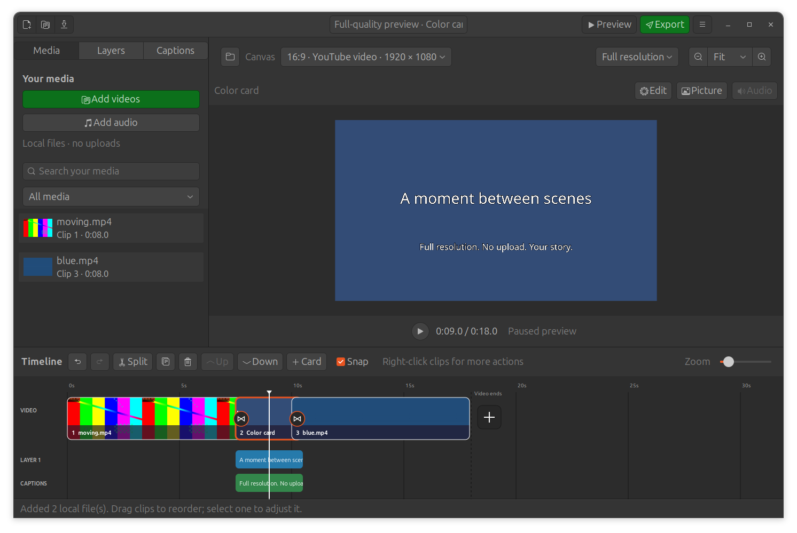
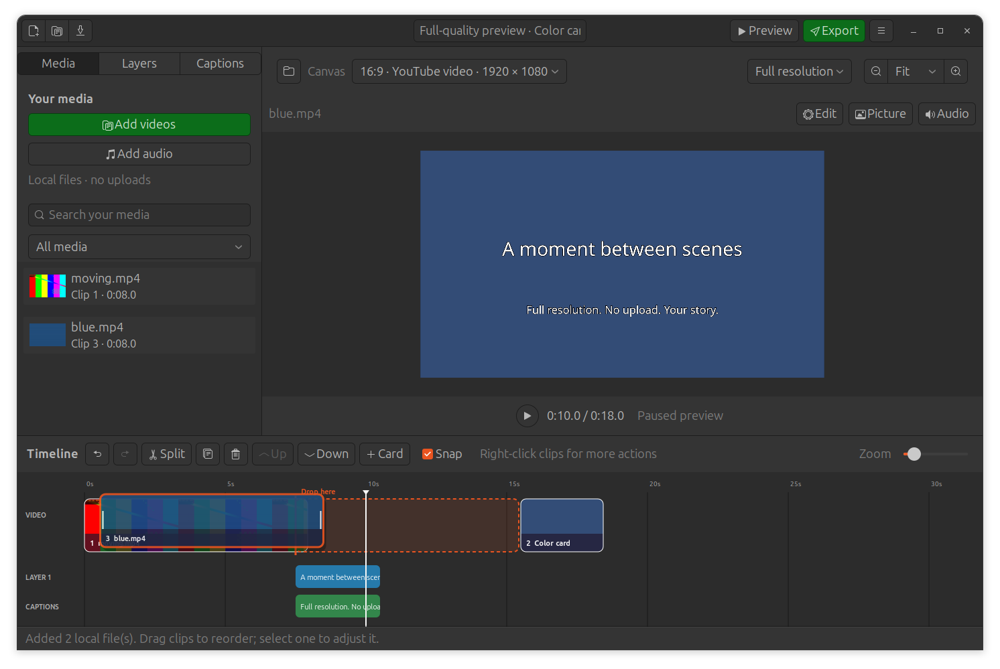

# Preview quality, color cards and lossless masters — 0.8.0

## Choose preview resolution

Above the canvas, **Full resolution** is the default and uses the project canvas
size. **HD preview** limits the longest edge to 1280 pixels; **Fast preview**
limits it to 640. Landscape 1080p therefore previews at 1920×1080, 1280×720, or
640×360; portrait uses the reversed dimensions. Small canvases are never enlarged
past their project size. View zoom is relative to Fit and remains separate.

The choice applies to live composition playback, white-playhead scrubbing,
paused selection pictures and optional rendered previews. Changing it preserves
position, previously playing state, zoom, project data and undo history. A
prepared preview cache key includes the resolution. The selection is per window;
a new launch starts at Full. Full 4K processing costs more CPU/memory and can
stutter. HD/Fast are explicit choices; the app never automatically reduces Full’s resolution.
Live playback and composed stills use unencoded frames. The optional prepared
preview is an H.264 file at CRF 18; Full there means full resolution, not a
lossless codec. Timeline/library thumbnails remain smaller navigation images. On-canvas layer
editing uses PNG source frames at the selected size.

## Export quality

The native export dialog defaults to **Maximum quality · MP4** (H.264 CRF 14,
AAC 320 kbit/s). High uses CRF 18 and Smaller uses CRF 23. Each reads originals at
the project canvas size and source-following FPS, regardless of preview choice
or zoom. MP4 is still lossy; exporting or uploading cannot restore absent detail.

**Lossless master · MKV** uses FFV1 level 3 video and 48 kHz stereo floating-point
PCM audio. It preserves the composed frames/audio without a lossy output codec.
It does not bypass source decoding, crop/scale, transitions, mixing or the current
8-bit YUV 4:2:0 composition. It is not source passthrough, HDR or high-bit-depth
mastering. These very large master files are intended for preservation/further
processing; MP4 remains the social upload format. The chooser supplies `.mkv`
for masters and `.mp4` for MP4. All modes protect source files, write a temporary
output beside the destination, and replace it only after successful completion.

## Insert and edit cards

Select a preceding clip and click **+ Card** above the timeline, or right-click
any clip for **Insert color card before… / after…**. Choose a color through the
native GTK color chooser and enter seconds. With no clip selected, the toolbar
inserts at the next clip boundary at/after the playhead, or at the end.

Cards are file-free solid-color scenes in the main sequence. **Edit** changes
the color/duration; the same popover edits the outgoing transition. Join buttons
also open those controls. Cards support edge trims (including extending duration),
split, duplicate, delete, reordering and undo/redo. They contain no source sound;
soundtracks continue across them. A cards-only composition can preview/export.
Use the existing Layers tools to place text, logos, images or video on a card.
Overlay, caption and soundtrack times remain absolute when the main sequence is
changed, so check them after inserting/resizing a scene.

Format 4 stores cards without a path. Formats 1–3 migrate on load; projects saved
by 0.8 require 0.8 or newer. Recovery and portable collection retain card data
without generating/copying a video. Relinking/media protection only visits real
file-backed items. The first file-backed main video supplies FPS; cards-only
projects keep the saved rate, initially 30.

## Drag feedback

After a small movement, a lifted clip thumbnail follows the pointer. Neighboring
clips make room around a dashed gap and **Drop here** marker; this previews the
new sequence without editing the project. Holding near a viewport edge scrolls.
Release commits one reorder/undo step; returning to the same slot does not add
history. Ordinary clicks still select, edge grabs trim, and the white line seeks.
Soundtracks and visual/caption bodies also move visibly while being dragged.

## Validation

82 automated checks cover rendering, project calculations and 15 native GTK
workflows, including actual local Tiny recognition. New checks cover:

- Landscape/portrait Full, HD and Fast composed picture dimensions; preview
  size choices leave final export size unchanged; prepared previews follow size.
- Lossless FFV1/float-PCM codecs, exact decoded YUV equality with the unencoded
  composed stream across a card transition, and silent cards-only audio.
- Cards among mixed-rate video sources, transitions, titles/captions, soundtracks,
  speech audio timing, source preservation, migration, invalid inputs, split,
  extension, recovery and portable collection.
- Native default Full pictures, quality switching while paused/playing, unchanged
  project/history, Maximum MP4 export default and availability of the MKV master.
- Native card insertion/color/duration editing, split, save/reopen, context menus,
  moving thumbnails/drop gaps, model preservation while held, one-step undo, and
  viewport-edge scrolling. A newer seek must retire an older paused picture.

Generated native fixtures were inspected in Yaru light/dark at 1920×1080 preview
resolution, with a card/title/caption and an in-progress reorder. Installed-package
checks repeat the same workflow. All media fixtures are generated; no user source
file is modified or uploaded.

