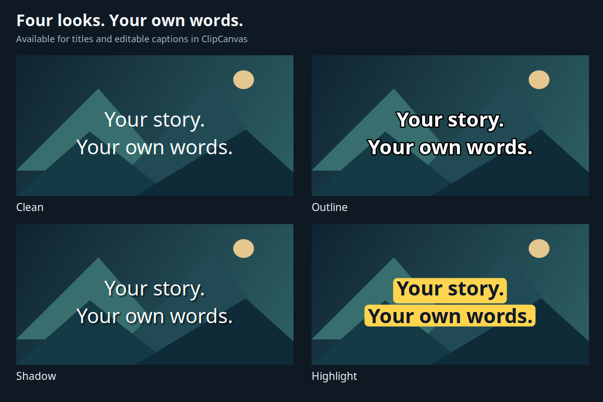
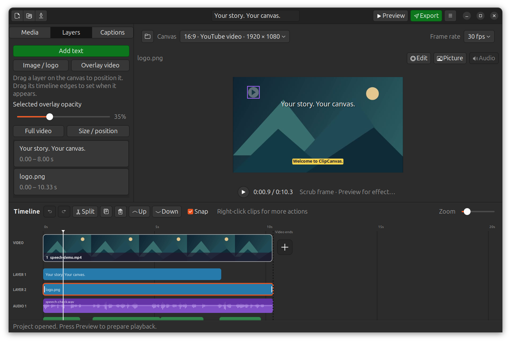

# ClipCanvas 0.5.0 validation

Checked on Ubuntu 24.04 on 10 October 2026 with GTK 3, Pango/Cairo, GStreamer,
FFmpeg and system Python 3.12. Media fixtures are generated video/audio and
original geometric artwork; no private user media was used or uploaded.

## Functional result

**57 tests passed, none skipped**, including eight native desktop workflows and
real local Tiny speech recognition, correction and MP4/SRT export. The complete
run took 51 seconds on this machine. Reproduce with the command in
[caption/layer validation](LAYERS-CAPTIONS-VALIDATION.md). CI supplies Xvfb and
skips the two optional real-speech checks without a provisioned model/fixture.

New checks cover:

- Four presets preserve editable wording, font family/size, geometry, timing
  and opacity. Save/reopen retains the effects; old format 3 style records gain
  transparent-shadow/full-box defaults without changing their prior appearance.
- All four title/caption looks produce distinct rendered results. Decoded MP4
  frames agree with the native renderer within the codec tolerance. Highlight
  backgrounds follow the text, with clear space outside the words.
- PNG's existing alpha multiplies with overall opacity on landscape/portrait
  canvases. Overlay timing remains correct before/after its visibility interval.
- Native title and caption editors use the same four presets; text remains
  editable after styling. Caption appearance is shared while words stay per cue.
  Slider dragging produces one undo entry and preserves the playhead; Full video
  sets the selected overlay's visibility to the current composition duration.
- Up/Down rearranges Video, individual overlays/soundtracks and shared Captions
  rows. Save/reopen and undo/redo retain the layout; deleted rows are ignored,
  new rows appear, and boundary arrows disable. Media sequence, source edits,
  visual stacking and cue timings do not change. A prepared preview remains
  usable. Join buttons, add-video action, fade handles and hit targets follow
  moved rows. Invalid/duplicate row identifiers are rejected.

Existing media, audio/WAV, transition, speech, project recovery, collection,
relinking and source-protection checks still pass. Compilation, native desktop
file validation and whitespace checks are also required before packaging.

## Native visual checks

Inspected the four style thumbnails, live sample and editable words in title and
caption popovers; the shared Caption appearance dialog; and the logo opacity
slider at 35%. Yaru dark and light presentations use native controls. A 1280×720
client area fits; properties/timeline scroll as needed. Larger desktop captures
show all rows and the new Up/Down controls. Selecting a moved row reveals it.

## Scope and compatibility

These are four original presets inspired by common text treatments, not a claim
that Canva defines an official set of four. Canva's official
[text effects help](https://www.canva.com/help/text-effects/) and
[text effects overview](https://www.canva.com/features/free-text-effects/)
informed the interaction choices; application code, thumbnails and fixtures are
original. Shadow softness uses a small weighted glyph offset kernel.

Styles remain static. Animated/karaoke word highlighting, translation, animated
caption packs and Windows installers remain pending. Caption style applies to
all cues; SRT stores words/timing only. Long words may require reducing font size
or increasing the bounded text area. Full video is an explicit timing action;
later base-clip edits do not automatically extend it. Timeline row placement does
not control visual front/back stacking. Use Picture's ordering controls for that.

Project format remains 3 with optional new effect/layout fields. Use ClipCanvas
0.5 or newer to retain their appearance/layout; 0.4 can ignore these additions.
Previous speech accuracy, overlay timing and high-quality H.264 limitations in
[0.4 validation](LAYERS-CAPTIONS-VALIDATION.md) continue to apply.
