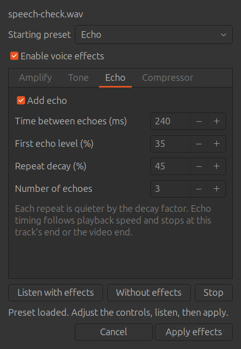
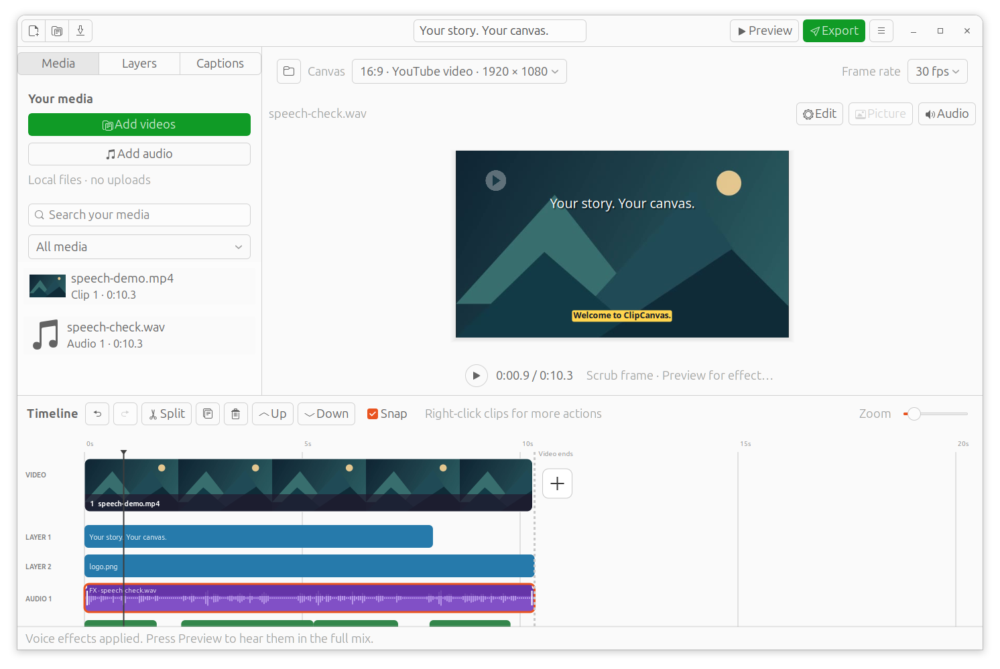

# Voice effects in ClipCanvas 0.6.0

Right-click a WAV, MP3 or other audio item in the timeline and choose
**Voice effects…**. The same control is in **Audio** and works on attached video
sound. Apply processing to the selected item without rewriting its source.

## Controls

| Tab | Controls | Purpose |
|---|---|---|
| Amplify | −24 to +24 dB gain | Raise/lower the recording, independently of track volume |
| Tone | Bass/treble ±18 dB; high-pass 0–1000 Hz, low-pass 0–20000 Hz | Adjust body/brightness and narrow the frequency range; a zero cutoff disables that filter |
| Echo | Enable, 40–2000 ms delay, first echo level, decay 0–95%, 1–8 repeats | Add equally spaced echoes with decreasing strength |
| Compressor | Enable, threshold −48–0 dB, ratio 1–12, attack/release, make-up gain | Reduce louder passages and adjust the processed level |

**Neutral** resets the effects. **Narration** starts with an 80 Hz rumble filter,
slight bass/treble lift and compression. **Telephone** uses 300–3400 Hz filtering.
**Echo** starts with three repeats 240 ms apart, a first repeat at 35% of the
dry signal and a 45% decay factor. Presets are starting points, not automatic
voice analysis. Subsequent edits show **Custom settings**.

Clear **Enable voice effects** to bypass while retaining settings. Click
**Listen with effects** or **Without effects** for the first 12 seconds of the
edited track; **Stop** cancels processing/playback. The comparison keeps trim,
speed, track volume and fades, changing only voice effects. Other tracks are not
included, so the complete mix may sound different. Audition uses temporary WAVs
and cleans them up when the dialog closes. **Cancel** leaves the project unchanged;
**Apply effects** makes one undoable change. Then use the main **Preview** to hear
the whole mix. Effects are included in MP4 export and full-mix caption input.

## Timing and processing

Processing order is source trim → pitch-preserving speed → tone filters →
compressor → gain → echo → track volume → fades → timeline placement → mix limiter.
Preview, export and audition share the effect-chain function. Echo milliseconds
are measured on the edited timeline, after speed conversion. A 200 ms echo stays
200 ms when playback speed changes. First echo level multiplies the dry signal;
each later repeat multiplies the previous repeat by the decay factor.

Echo ends at the item's trimmed duration or the video boundary. It does not
extend a row/composition or continue across a cut. Leave silence inside the
track's selected source range if final words need room to echo. Fades also fade
the echoes. Splitting creates two independently processed items; delay/filter
state starts anew at the split. Duplicating retains independent settings.
Extracting audio retains the original clip's effects and mutes its attached sound.
Original-video speech recognition restores clip volume and bypasses voice effects;
full-mix recognition uses the effects heard in the project.

The timeline's **FX** marker indicates active processing; its waveform still
represents the original file. Gain is a fixed adjustment, not loudness
normalization. The existing final mix limiter also limits isolated audition.
Limiting high gains can change dynamics. Source files stay unchanged.

Implementation uses FFmpeg's documented [audio filters](https://ffmpeg.org/ffmpeg-filters.html),
including aecho, bass/treble, highpass/lowpass, volume and acompressor. The delay/
decay interaction draws on familiar [Audacity echo concepts](https://manual.audacityteam.org/man/echo.html).
ClipCanvas remains custom code; this is not an Audacity fork or plugin host.

## Validation

Checked on Ubuntu 24.04 on 11 October 2026 with system Python 3.12, GTK 3,
GStreamer and FFmpeg. **64 tests passed, none skipped**, including nine native
desktop workflows and the provisioned real Tiny speech checks. The full run
took 41 seconds on this machine. CI supplies Xvfb and skips the two optional real
speech checks when no model/audio fixture is provided.

New tests use generated impulses, tones and level changes:

- WAV and MP3 echo delay/decay after source trim, 2× speed and timeline offset,
  in both prepared preview and final MP4; repeats stop at the item boundary.
- Actual +6 dB amplitude change, bypass, audition/export agreement, and unchanged
  source hashes; peak limiting is measured per channel.
- Bass lift, treble reduction, telephone-band filtering and compressed loud/quiet
  ratios measured from decoded samples.
- Extraction retains effects; original-video recognition bypasses them.
  Cancellation preserves an existing output; source overwrite is rejected.
- Presets/defaults, invalid values, project save/reopen and independent split
  settings; native right-click entry, A/B listening, cancel/apply, temporary-file
  cleanup, playhead preservation and undo/redo.

Existing video, WAV mixing, caption recognition, layer rendering, project recovery,
collection/relinking and movable-row checks still pass. Native Yaru dark/light
echo, gain and compressor tabs were captured and inspected. Python compilation,
desktop-file validation and whitespace checks pass before packaging.

## Scope

Effects apply to a complete timeline item. To treat only part, split it first.
Selection-based waveform editing, live processing of the complete mix, meters,
automatic normalization, pitch shifting, reverb, noise removal, automation curves
and external LADSPA/VST/LV2 plugins remain separate work. Windows packaging is
still pending. Projects keep format 3 with optional voice-effect settings; use
0.6 or newer to retain processing because earlier versions may ignore them.
